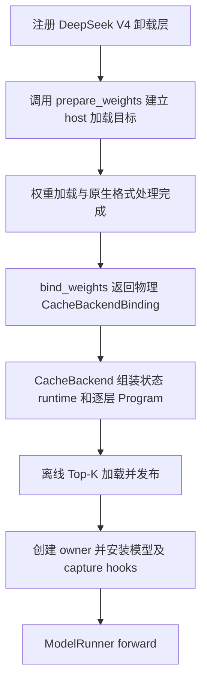
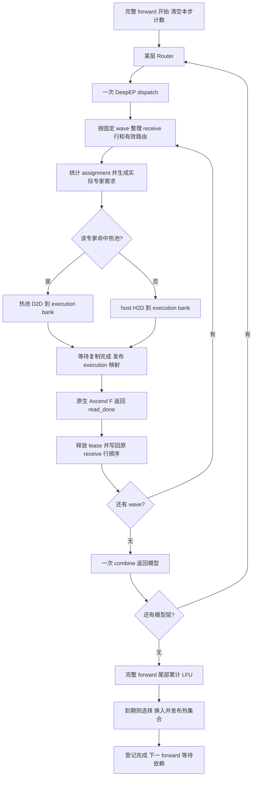
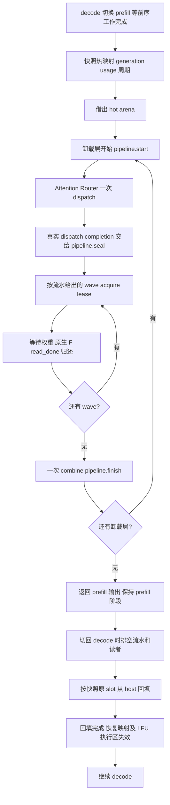

# MoE Cache 与框架适配实现总结

> 历史设计：当前 API 与后续简化见[精简记录](doc/SIMPLIFICATION_20261025.zh-CN.md)和[缓存契约](doc/CACHE_IMPLEMENTATION.zh-CN.md)。

> **历史设计快照**：正文保留当时方案与接口，其中重复缓存栈、phase controller、旧策略 API
> 已被后续实现替换，不应据此恢复旧模块。当前接口、迁移与验证状态见
> [2026-10-25 重构记录](doc/REFACTOR_20261025.zh-CN.md)。

> 2026-10-22：本说明保留上游缓存提交的设计与验证记录。当前原生 NPU 入口复用其中的
> `PeriodicLFUPolicy` 与 `CacheRouteStats`，通过现有 ACL/MemFabric 后端执行搬运；
> 具体接入和当前测试方法见 [原生周期缓存](npu/doc/PERIODIC_CACHE_1022.zh-CN.md)。
> 原生服务仍要求完整 decode graph，不使用本说明中通用缓存 runtime 的 eager decode 路径。

本文总结本分支完成的 cache 算法与框架适配：实现了哪些功能、代码如何组织、prefill / decode 如何执行，以及如何验证这些改动。接口部分说明本次实现提供或调用的方法，验证部分区分已通过的测试与测试覆盖范围。

本分支 `codex/moe-cache-integration` 基于 `59cbb5d`，从开发分支 `12382f2` 选取生产代码、CPU 测试和本文。生产代码对应 `a29b739` 的精简版本。本分支不包含开发阶段的三个 NPU 手工验证脚本及其辅助测试。

## 1. 目标与已实现功能

目标是在 HBM 放不下全部 routed expert 权重时，使用有限热缓存减少 decode 的 H2D；prefill 复用热池空间执行流式加载，结束后恢复 decode 缓存。

当前接入 **DeepSeek V4 + Ascend + compact DeepEP**。支持普通 DECODE / IDLE、EXTEND / MIXED 的阶段编排。前三层、hash 层和 shared experts 保持原有常驻规则。verify / speculative、split prefill、TBO/SBO、MoE TP、弹性或重映射 EP 等原分支限制没有解除。没有新增生产后端默认注册或一键 serving CLI，沿用 ModelRunner 的 offloader 注入入口。

| 已实现功能 | 具体行为 |
| --- | --- |
| PeriodicLFU 与 batch 统计 | 离线 Top-K 初始化、有效 assignment 计数、rank 内跨层冷热配对、周期替换与衰减 |
| Decode 缓存执行 | 根据实际需求选择热池或 host 来源，生成执行计划，等待复制后发布映射，计算读完后允许复用 |
| Prefill 阶段适配 | 保存 decode 元数据和 LFU 状态，调用借池与流水接口，切回 decode 时按原 slot 回填并恢复状态 |
| 模型与算子适配 | 安装 DeepSeek V4 层首及 routed experts 入口，转换 DeepEP receive 布局，通过 bank 视图调用原生 Ascend F |
| Runtime 与 graph 生命周期 | 组装逐层 Program，接入 eager / capture / replay，管理统计开关、完成事件及 graph lease |
| 自动化验证 | CPU UT 覆盖算法、执行计划、模型安装和 graph 生命周期；开发阶段 NPU 验证记录单独说明 |

实现复用已有 `ResidencyOps` / `WholeMoEProgram`、公共权重访问层和传输接口。本次新增的是 cache 决策、状态管理及实际框架接线；底层传输、存储和流水通过注入的 backend 对象调用，不将这些依赖本身计为本次实现。

基础版只保证正常执行所需的事件、读者和生命周期约束，不增加预测器、跨 rank 热度协调、自动容量调整、失败重试或额外权重备份池。

## 2. 数据与内存模型

### 2.1 专家身份、rank 与 slot

一个专家由 `(layer_id, expert_id)` 标识；不同层的 E0 是不同权重。每个 EP rank 只保存、统计和缓存自己负责的专家，token 的激活通过 EP dispatch 送到专家所属 rank。

本 rank 的 `ExpertCatalog` 将可卸载专家展开成连续 canonical key：

```text
rank 内有 L3、L4 两层，每层 4 个本地专家：
L3/E0..E3 -> key 0..3
L4/E0..E3 -> key 4..7
```

离线文件使用全局 expert ID；dispatch 后统计使用本 rank、本层的 local expert ID；搬运计划的 HOST 来源使用 canonical key；HOT_SLOT 来源使用物理热 slot。四者不能混用。

### 2.2 三类存储

| 存储 | 用途与寿命 |
| --- | --- |
| CPU pinned / 注册后的 host store | 完整只读专家 bundle；包含权重、scale 等原生格式组件，淘汰无需 D2H 写回 |
| HBM hot pool | 跨 decode forward 保留热专家；prefill 可借用 |
| HBM execution pool | 当前 wave 的连续权重输入；计算完成后可覆盖 |

```text
N = 当前 rank 所有可卸载专家数
K = floor(cache_ratio * N)
热池总 slot 数 = K
所有 execution bank 的 slot 总数 = execution_slots
```

`bank_slots` 是单个执行 bank 的容量，所有 bank 都计入 `execution_slots`；借用视图不重复计入物理分配。当前 CacheBackend 要求各卸载层的本地专家数量一致，并使用兼容的原生组件布局。

**命中仍需 D2D 到 execution bank**，miss 则 H2D 到该 bank。当前实现不直接把任意离散热 slot 交给原生 F。缓存减少的是 host→device 搬运，不是消除全部复制。

### 2.3 元数据

| 状态 | 含义 |
| --- | --- |
| `key_to_slot[N]` | 专家到热 slot；未驻留为 -1 |
| `slot_to_key[K]`、`slot_valid[K]` | slot 当前专家及完整 bundle 是否可读 |
| `slot_generation[K]` | slot 内容更新版本 |
| `execution_key[S]`、`execution_valid[S]` | 临时执行池内容 |
| `step_access_count[N]`、`update_enabled` | 当前完整 forward 的路由计数与统计开关 |
| `usage[N]` | 在线热度，float32 |
| `step_mod`、`update_due` | 4 步周期及本步是否调整 |
| `target_keys[K]` | 策略选中的目标集合；数组位置不是 slot |

热 slot 本身不绑定层。LFU 可以用某层的冷专家腾出 slot，装入另一层的热专家；residency 保留幸存者原位置，将新增 key 分配到空出的物理 slot。共享池总容量不变，各层驻留数量随在线热度变化。

## 3. LFU：五项需求及准确语义

### 3.1 参数

对应 [periodic_lfu.py](periodic_lfu.py)：

```python
@dataclass(frozen=True)
class PeriodicLFUConfig:
    offline_stats_path: str
    update_interval: int = 4
    min_usage: float = 2.0
    replacement_min_gain: float = 1.5
    max_swaps: int = 96
    usage_decay: float = 0.7
```

| 需求 | 当前实现 |
| --- | --- |
| 离线初始化 | 在本 rank 全部可卸载专家中选离线频次 Top-K，装入热池 |
| 在线计数 | 每个有效 token→expert assignment 加 1，命中与 miss 均计数 |
| 周期替换 | 每 4 个有效完整 decode forward，在本 rank 所有可卸载层中全局冷热配对 |
| 换入上限与衰减 | 冷专家 usage 降序与热专家 usage 升序配对；候选 usage ≥ 2、差值 ≥ 1.5，每 rank 最多 96 对；随后全部 usage × 0.7 |
| 搬运与发布分开 | 等完整 bundle 搬完后发布；异步提交和实际计算重叠分别看待 |

1.5 是**差值**，不是 1.5 倍，等号满足门槛。每轮即使没有交换也衰减；非周期轮不衰减。

初始化和运行期都允许跨层选择。初始化为零配额的层也能在维护时换入，缓存配额不受离线初始化锁定。专家 EP 归属不变；当前同一个池内要求完整权重 bundle 的格式和物理大小兼容。

周期策略捕获普通/维护两种完整 decode 图。普通图只累计访问次数和周期，维护图在完整 batch 末尾排序并更新热池。host 根据有效 decode batch 的提交次数选图，不回读设备热度或 due。计数跨 bucket 共用，prefill、warmup/capture 和全局空步不推进。本改动的 CPU 策略和模拟图契约已检查，真实 A3 双图捕获与性能尚待验证。

原五点需求提到 verify，但当前 serving 接入仍拒绝投机解码。本文不将 verify 列为已实现功能。

### 3.2 离线统计与初始化

示例：

```json
{
  "model_id": "checkpoint-used-for-profiling",
  "layers": {
    "3": {"0": 1200, "1": 900, "2": 500, "3": 100},
    "4": {"0": 300, "1": 1800, "2": 600, "3": 200}
  }
}
```

`model_id` 必须与初始化传入值一致。频次必须有限且非负；缺失专家按 0 处理。各 rank 只选自身拥有、允许卸载的专家。频次相同按 canonical key 升序打破平局。

```text
建立 catalog → 计算 K → 离线 Top-K
→ prepare_refill(exact_slot_keys) → H2D → 等待 → 发布
→ usage 全零、周期为零 → 允许 forward
```

离线频次不注入在线 usage，避免历史样本量压制当前请求。

### 3.3 Batch 计数和周期

计数点在 **EP dispatch 之后**，输入是本 rank 实际接收的有效分配。多个 token 选同一专家分别计数；top-k 中每个有效分配分别计数，不按 gate 权重加权。加载时才对专家需求去重。

- 不把 padding、无效 ID、其他 wave 的分配计入当前 wave。
- 一个完整 batch forward 只推进一次周期，不按 token、层或 wave 推进。
- prefill、warmup、capture 不累计热度、不推进周期；真实 graph replay 按开关计数。
- 全局空步不推进；全局有工作但本 rank 无本地分配时仍推进，计数为零。
- 全局 prefill 时，本地 IDLE / DECODE rank 也按 prefill 阶段处理，避免各 rank 借池时机不一致。

### 3.4 替换算法

以下是语义伪代码；生产实现使用设备 Tensor，不在 decode 在线路径回读路由和热度到 CPU。

```python
usage += this_forward_counts
step_mod = (step_mod + 1) % 4
if step_mod != 0:
    return

pairs = []
for layer in offloaded_layers:
    candidates = nonresident_sorted_by_usage_desc(layer)
    victims = resident_sorted_by_usage_asc(layer)
    for candidate, victim in zip(candidates, victims):
        gain = usage[candidate] - usage[victim]
        if usage[candidate] >= 2 and gain >= 1.5:
            pairs.append((gain, candidate, victim))

# 所有层竞争本 rank 的最多 96 次交换；候选/被替换者仍来自同一层。
selected = largest_gains(pairs, limit=96)
target_keys = replace_in_current_set(selected)
usage *= 0.7
# 实际选取、finish_step 和 apply_update 由 coordinator 按顺序衔接。
```

同热度按 key 稳定排序；同差值按层及专家的确定顺序处理。一次选择基于同一份热度，不把刚换入的专家再次参与本轮配对。

### 3.5 一个 batch 的完整例子

L3 热池内是 E0、E1，第四次 forward 前 usage 为 `[1, 0, 2, 1]`。这次 batch 在该层的有效本地分配是 `[E1, E2, E2, E2, E3]`：

| 专家 | 本步计数 | 选择前 usage | 当前计算权重来源 |
| --- | ---: | ---: | --- |
| E0 | 0 | 1 | 本次不需要 |
| E1 | 1 | 1 | 热池 D2D |
| E2 | 3 | 5 | host H2D，只准备一份权重 |
| E3 | 1 | 2 | host H2D |

当前计算先正常完成。到**整个模型 forward 尾部**，E2(5) 与 E0(1) 配对，差 4，通过；E3(2) 与 E1(1) 差 1，不通过。若 E2 这对进入 rank 内前 96，则热池换成 E2、E1，随后 usage 为 `[0.7, 0.7, 3.5, 1.4]`。

E2 的临时 execution 权重和尾部晋升热池是两次不同用途的加载，基础版允许再次 H2D，不增加暂存池。E3 虽然本次被使用，仍不自动驻留。

## 4. 执行流程

### 4.1 初始化与模型安装



`DeepSeekV4ProgramBinding` 安装 decoder pre-hook，同时包装 NPU 模型直接调用的 `forward_hc_pre_from_prev`。该直接方法不触发 Module hook，所以两种入口都需覆盖。routed experts 的 forward 被接到 Program；Attention、Router、shared experts 和模型缩放保留原路径，输出裁剪及必要 reduction 保留。close 时恢复原方法。

### 4.2 Decode：一次 D、分组 F、一次 C

当前 CacheBackend 选择的是 `DispatchOnceProgram`，不是每个 wave 重复一次通信。



固定 wave 只限定执行范围，不等于必须搬完范围内全部专家。没有真实需求的 lane 不搬运。空 wave 仍沿用固定本地执行结构，整层仍只有一次 dispatch / combine。

当前 decode 串行复用计划和执行 bank；异步 copy 接口加事件保证正确性，**不代表已实现下一 wave 的搬运与当前 F 重叠**。跨 wave 优化流水不是基础 cache 算法的一部分。

### 4.3 Prefill：借池、流水、恢复



本次适配在层首调用 `pipeline.start`，在 dispatch 后传入真实完成依赖，并按 `seal` 返回的分组执行 acquire / wait / F / release。层首通知为流水在 Attention / Router / 通信期间预取提供入口；具体调度沿用注入的 pipeline。prefill 不调用 decode 的热度更新，也不使用其按需 DeviceCopyPlan provider。

快照只保存元数据和策略状态，不备份一份专家权重。恢复依赖 host store 已有的完整只读权重。`prepare_refill(slot_keys)` 精确恢复位置，不能用普通 `apply_update(target_keys)` 替代：目标集合相同不保证 slot 顺序相同。

### 4.4 热替换与完成语义

```text
等待旧 bank / 热权重读者
→ 准备目标 slot 和 copy plan，victim 有效位置 false
→ copy stream 等待计划就绪并复制完整 bundle
→ compute stream 等待 weights_ready
→ commit_update 发布双向映射、有效位及 generation
→ 记录 residency_ready / resources_idle
→ 后续 forward 才使用新映射
```

复制完成与发布完成是两个不同事件。transport 不直接写 cache 映射。覆盖 slot / bank 之前还必须等待旧读者；只等本次 H2D 完成不够。

`output_ready` 表示输出，`residency_ready` 表示驻留元数据，`resources_idle` 要覆盖全部计算、复制、通信和 prefill worker。只有这些工作已汇入同一流时，该流的最终 event 才能代表整体结束。

## 5. 实现接口与调用关系

接口以 [interfaces.py](interfaces.py)、[execution.py](execution.py)、[prefill.py](prefill.py)、[transfer.py](../transfer.py) 为准。`CacheBackend` 负责组装，`CacheRuntime` 负责生命周期，`TensorResidencyOps` 实现缓存计划与发布；权重访问和流水执行复用已有公共接口。

### 5.1 CacheBackend 组装入口

```python
backend = CacheBackend(
    model_id=model_id,
    prepare_weights=prepare_weights,  # (decoder, spec)
    bind_weights=bind_weights,        # (layers, catalog, config) -> CacheBackendBinding
    close_weights=close_weights,      # drain / graph 销毁后释放物理注册资源
)
offloader = MoEOffloaderV2(
    config,
    backend,
    periodic_lfu_config=PeriodicLFUConfig(offline_stats_path),
)
# 使用现有 ModelRunner(..., moe_offloader=offloader) 注入入口。
```

这是 `CacheBackend` 的组装示意。它通过三个注入回调访问权重存储：注册层时调用 `prepare_weights`，finalize 时调用 `bind_weights`，资源排空后调用 `close_weights`。收到 binding 后，创建状态、runtime、逐层 Program、模型 installer 和初始化热池均由本次新增代码完成。示例省略具体后端实例，不是独立的模型启动脚本。

`CacheBackendBinding`（历史 `cache_backend.py`） 的全部字段：

| 字段 | 类型 / 要求 |
| --- | --- |
| `device_module`、`device` | 设备 API；torch.device 或 str |
| `compute_stream`、`copy_stream` | 计算流和复制流 |
| `transfer` | `WeightTransferBackend` |
| `hot_bindings`、`execution_bindings` | `ExpertBankBindings`，原生权重 / scale Tensor 和 bank 起点 |
| `prefill_pipeline` | 具体 `PrefillWeightPipeline`，包含自己的 HOST_ONLY access |
| `borrow_hot_arena` | 无参数借池回调 |
| `resources` | `tuple[Allocation, ...]`，物理存储和流水分配只计一次 |
| `expert_nbytes` | 完整专家 bundle 字节数 |
| `bank_slots` | decode 单个 bank 的 slot 数 |
| `max_dispatch_rows` | receive / 分组缓冲区最大行数 |
| `hidden_size`、`output_dtype` | 原生专家输出宽度和类型 |
| `capabilities` | 经后端确认的 `RuntimeCapabilities` |

`ExpertBankBindings.components` 使用 `AscendQuantInfo` 字段名，至少包含 `w13_weight`、`w2_weight`，并提供模型需要的 scales / offsets / biases。不同模型属性名在物理 binding 时映射，不在 cache 中重新量化或改写 Parameter。

decode `execution_bindings.bank_offsets` 必须为 `0, bank_slots, 2*bank_slots, ...`；物理目标 slot 为 `wave.bank * bank_slots + lane`。prefill 可提供借池后的不同视图，但不得重复分配或漏报实际占用。

### 5.2 路由、residency 和公共 access

| 接口 | 责任 |
| --- | --- |
| `LocalRoutes(expert_ids, valid)` | IDs 为本 rank、本层 local ID，int32/int64；valid 为同形状 bool；保留重复 assignments |
| `runtime.make_execution_request(layer_id, routes, wave, context)` | 统计并产生 `ExecutionRequest`；`local_demand` 是 execution 池长度的 key 向量，不需要的 lane 为 -1 |
| `resolve_execution(request, context)` | 返回 `ExecutionReservation`：copy plan、bindings、依赖和保活对象 |
| `publish_execution(reservation, weights_ready, context)` | 等权重后发布 execution 元数据，返回发布票据 |
| `finish_execution(reservation, read_done, context)` | 登记最终读者，保护下一次计划 / bank 复用 |
| `prepare_update(target_keys, context)` | 保留幸存 slot，为新增专家生成公共 `UpdatePlan` |
| `commit_update(plan, weights_ready, context)` | 等待后发布热映射，返回发布票据 |
| `prepare_refill(slot_keys, context)` | cache 生命周期专用，精确位置初始化 / 回填，不执行 LFU |

公共调用链：

```text
DecodeLocalExpertProgram
→ ExpertWeightAccess.stage(request, context)
→ residency.resolve_execution
→ transfer.materialize_into
→ residency.publish_execution
→ access.wait_ready(lease, compute_stream)
→ native F → LocalExecution(output, read_done)
→ access.release_after(lease, read_done, context)
```

周期更新由 `CacheUpdateCoordinator.emit_step_end(context, adjust=...)` 统一调用策略统计、选择、`finish_step` 和 `access.apply_update`。metadata 层不再重复编排收尾。

### 5.3 生成的搬运计划与传输调用

```python
materialize_into(device_plan, bindings, stream) -> TransferTicket
materialize_host_into(host_plan, bindings, stream) -> TransferTicket
```

| DeviceCopyPlan 字段 | 含义 |
| --- | --- |
| `source_kind: int64[C]` | NONE=0、HOST=1、HOT_SLOT=2 |
| `source_index: int64[C]` | HOST 使用 canonical expert key；HOT_SLOT 使用热 slot |
| `destination_slot: int64[C]` | bindings 对应目标池的实际 slot，不是压紧后的条目序号 |
| `valid: bool[C]` | 每条是否有效，允许空洞 |
| `count: int64 scalar` | valid.sum()，0 是正常空操作 |
| `expected_generation: int64[C]` | HOT_SLOT 来源版本；HOST / NONE 为 0 |
| `capacity: int` | 静态容量，计划 Tensor 地址固定 |

例如 `valid=[False, True, False, True]`、目标 `[0,1,2,3]`、count=2，必须写 slot 1、3，不能压紧到 0、1。

一个条目代表完整专家 bundle。cache 通过公共 access 提交计划，等待返回 ticket 后才发布映射；因此该 ticket 的语义是完整 bundle 复制完成。当前 `TensorResidencyOps` 生成 decode/cache 的 DeviceCopyPlan；prefill 路径使用 pipeline 自身的 access 和 HOST_ONLY reservation。本次没有另写底层搬运实现。

### 5.4 已接入的 Prefill 流水调用

| 接口 | 调用时机 |
| --- | --- |
| `start(layer_id, context)` | 卸载层开始，提前启动加载 |
| `validate_session(layer, context)` | 本层 Program 执行前检查 session |
| `seal(layer, dispatch_ready, context)` | 一次 dispatch 后，接真实 Completion，返回本层 waves |
| `acquire(layer, wave, context)` | 返回对应分组的 WeightLease |
| `finish(layer, context) -> TransferTicket` | 本层执行结束，汇合流水工作 |
| `abort(context) -> TransferTicket` | 失败 / prefill 清理时停止提交、汇合工作 |

F 返回的 `read_done` 必须覆盖所有读权重的计算流，再通过 `release_after` 归还 lease；后台 worker 不能提前覆盖该区域。

## 6. 框架、Ascend 和 graph 适配

### 6.1 Forward 与捕图

- `forward_scope` 包住一次实际 eager 或 graph replay，处理全局阶段、前序等待和完成登记。
- eager 执行调用 `eager_step_scope`；replay 不重复调用 Python step hooks。
- capture head/tail 捕获 step begin/end 的设备操作；统计开关使用固定地址 Tensor，capture/warmup 关闭，真实 replay 开启。
- eager 维护一个 host 周期镜像，跟随有效完整 forward 推进，用于跳过非调整轮的排序和热池计划；无需读回设备周期。replay 后同样推进镜像，切回 eager 保持一致。
- 图内保留固定操作序列，由设备门控交换；没有声称已消除图内非周期排序开销。
- NPU graph backend 在 warmup 前取得 owner lease，捕获成功才允许 replay。失败图也由 cleanup 排空并销毁后释放 lease，防止权重资源早于图释放。

`RuntimeCapabilities.require_decode()` 门槛保留。metadata 能捕图、单次 H2D 能执行，都不足以声明完整生产 decode graph 可用。

### 6.2 Ascend 原生计算

`AscendDeepEPDispatcher` 保留原 dispatcher 的调用约定及通信 hooks，兼容关闭 TBO 后单个 inner 的 `MaybeTboDeepEPDispatcher`。

`AscendDispatchLayout` 处理本分支 NPU 的二维 compact receive：有效行按专家组织；LL counts 留在设备端，NORMAL counts 仅用于 eager prefill。每 wave 整理激活和 scale，F 后恢复原 receive 顺序，再调用一次 combine，不重复施加 top-k 权重。

当前为基础固定容量整理。剩余零 padding 计入最后一个 F lane 的算子行数，F 后屏蔽；padding 不计入 LFU 或加载需求。它有额外计算开销，尚未实现专门的高性能打包 kernel。

`AscendExpertRunner` 从 bank 构造原生 `AscendQuantInfo` 视图并调用 `AscendRunnerCore.run`；不新增量化格式或 GMM 算子。

## 7. 修改文件与职责

以下按相对 `59cbb5d` 的最终净差异列出本次修改，涵盖新增模块、已有框架调用点和测试。新增模块依赖这些公共接口及 ModelRunner 修改才能形成完整调用链。

### 7.1 新增七个生产文件

| 文件 | 单一职责 |
| --- | --- |
| [periodic_lfu.py](periodic_lfu.py) | 离线热启动与周期 LFU |
| [cache_metadata.py](cache_metadata.py) | 路由统计、策略状态与快照 |
| `cache_residency.py`（已退休） | 设备计划、slot 分配、发布及读者保护 |
| `cache_runtime.py`（已退休） | cache 生命周期、forward / capture 和阶段切换 |
| `cache_backend.py`（已退休） | 物理 binding 到真实 runtime / Program 的组装 |
| `model_binding.py`（已退休） | DeepSeek V4 模型方法安装与恢复 |
| `ascend_adapter.py`（已退休） | DeepEP 布局与原生 Ascend F 适配 |

### 7.2 已有文件的功能修改

以下路径相对 `python/sglang/srt/`：

| 文件 | 修改内容 |
| --- | --- |
| `offloading/moe/__init__.py` | 导出新功能 |
| `offloading/moe/interfaces.py` | LocalRoutes 和策略收尾等公共契约 |
| `offloading/moe/execution.py` | coordinator 接入周期收尾与 eager adjust |
| `offloading/moe/offloader.py` | 创建 PeriodicLFU 并接通 runtime |
| `offloading/base.py` | eager step scope 入口 |
| `model_executor/model_runner.py` | eager / replay 分流与 scope 调用 |
| `hardware_backend/npu/graph_runner/npu_cudagraph_backend.py` | MoE owner graph lease 与清理 |

`offloading/transfer.py` 相对该基线仅有格式调整，无功能变更。`programs.py`、`prefill.py`、`owner.py` 等基础设施直接复用，不计为本次新增实现。

### 7.3 测试与文档

`test/registered/unit/offloading/` 中新增六个文件并修改一个文件：

- `test_periodic_lfu.py`
- `test_cache_metadata.py`
- `test_cache_runtime.py`
- `test_cache_integration.py`
- `test_cache_model_binding.py`
- `test_npu_moe_graph_lifetime.py`
- `test_moe_framework.py`（修改）

本分支不包含 `test_moe_cache_runtime_npu.py`、`test_moe_cache_metadata_npu.py` 和 `validate_moe_cache_npu.py`。仅测试这些脚本辅助逻辑的 `test_cache_npu_test_support.py` 也未选入，避免导入不存在的脚本。生产功能测试保持不变。

本文 `CACHE_DESIGN.zh-CN.md` 汇总上述实现和验证，不依赖其他专项或历史文档。

### 7.4 已完成的代码精简

- `CacheRuntime` 显式持有 `model_binding`、`prefill_pipeline` 和关闭回调，删除空安装回调、外部私有字段赋值及动态挂载 pipeline 的做法。
- 模型安装统一为 `model_binding.install(runtime)`，去掉未使用的安装参数；关闭时恢复方法和 hooks，测试覆盖部分安装失败后的清理与重新安装。
- `LocalRoutes` 统一放在公共 `interfaces.py`，Ascend adapter 不再为该数据结构依赖 runtime 模块。
- 删除没有生产调用方的 `record_global_routes()`，计数入口统一使用 dispatch 后的 local expert ID。
- 复用 metadata 的 `layer_layout`，去掉 runtime 中重复的层信息；由公共 coordinator 统一完成 LFU 收尾。
- 保留独立的精确回填路径，因为它需要恢复原 slot，语义不同于周期热集合替换。

## 8. 验证方法和已知结果

### 8.1 运行本分支的 CPU UT

从仓库根目录，在有 PyTorch 的 Python 环境中执行以下命令（Linux shell 示例）。这套测试不需要模型权重或 NPU，也可以在 NPU 机器上运行，但验证的是 CPU 逻辑。

```bash
python - <<'PY'
import pathlib
import sys
import types
import unittest

root = pathlib.Path.cwd()
sglang = types.ModuleType("sglang")
sglang.__path__ = [str(root / "python/sglang")]
sys.modules["sglang"] = sglang
suite = unittest.defaultTestLoader.discover(
    str(root / "test/registered/unit/offloading"), pattern="test_*.py"
)
result = unittest.TextTestRunner(verbosity=2).run(suite)
sys.exit(0 if result.wasSuccessful() and result.testsRun == 132
         and not result.skipped else 1)
PY
```

轻量 package bootstrap 让测试读取当前 checkout 的真实子模块，绕过与这些测试无关的 serving 顶层依赖。预期运行 132 项测试；比原开发分支少的两项仅验证已排除的 NPU 手工脚本辅助逻辑。

### 8.2 开发阶段 NPU 测试记录的覆盖范围

下述测试位于开发分支，不随本分支合入。保留记录用于说明实现已有的验证证据，不作为本分支可直接执行的测试命令。

`npu_runtime` 使用两个逻辑层、每层四个专家，四个热 slot、两个执行 slot，每专家两块 8×8 FP32 矩阵：

- pinned host→HBM 的 H2D、热池→执行 bank 的 D2D 及真实 event wait。
- 重复 assignment 计数，第四次 forward 后 LFU 更新，下一步命中与参考计算一致。
- 复制已完成但未 commit 时新映射仍不可见；commit 后才发布。
- 模拟 prefill 覆盖热池后，按原 slot 回填并恢复映射、generation、usage、周期，执行区失效。

该测试的搬运器先把设备计划读到 host，再提交真实 NPU copy，不能用于 decode graph 或性能验收。dispatch 是脚本数据，prefill 覆盖是模拟写入，F 是小矩阵计算。

`npu_metadata_graph` 验证算法状态的设备执行和固定地址 replay，不包含完整权重搬运图。`npu_layout` 使用生产布局适配器，覆盖空输入、动态 counts、部分尾 wave、scale 和 padding；测试 F 为简单运算，不是原生量化 GMM。

因此这六项测试不覆盖：真实多卡 DeepEP/HCCL、原生 Ascend MoE GMM / 量化结果、生产 transfer/prefill、完整 DeepSeek 推理、性能与实际拷贝重叠。

### 8.3 已有验证记录

- 原开发分支 `a29b739` 代码精简后，本地 **134 项 CPU UT 通过**。本分支排除两项手工脚本辅助测试后，重新运行 **132 项 CPU UT 全部通过，无 skip**（2026-10-21）；Ruff 和差异检查通过。
- 用户回报精简前版本：133 项 CPU UT、3 项 NPU runtime、1 项 metadata graph、2 项 layout 全部通过；无改断言、skip 或 CPU fallback。
- 用户报告环境：B072 镜像、torch_npu 2.10.0.post6。完整 report.json / 日志尚未归档到本工作区；该结果按用户回报记录，不外推为 `a29b739` 的实机复验。
- 上述 NPU 结果不表示本分支已完成真实模型、生产搬运后端或完整 decode graph 的实机验证。

### 8.4 如何检查本分支的验证结果

记录 `git rev-parse HEAD` 和工作区状态，运行第 8.1 节命令，检查 132 项测试全部通过且无 skip。保留完整测试输出。算法、计划、安装和公共调用链测试使用真实生产 Python 代码，通信和硬件算子依赖使用测试实现；不能将 CPU 通过解释为 HCCL 或 NPU kernel 验收完成。
