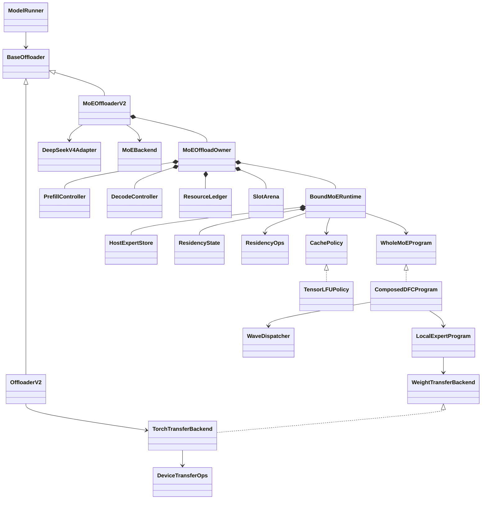

# MoE offload framework

This package provides the framework for DeepSeek V4 Flash routed-expert offload.
It is opt-in and **does not yet provide an A5 or CUDA inference backend**. Full
decode graph remains a required backend capability, not an eager fallback.
The CPU contract suite validates the framework and tensor LFU, not accelerator
graph capture, native FP4 repacking, HCCL/DeepEP, or performance.

## Entry points and growth from V2

`ModelRunner(..., moe_offloader=MoEOffloaderV2(config, backend))` is the development
entry point. It passes the explicit instance through `create_offloader()`.
There is no serving CLI switch until a concrete backend passes the graph gate.
Normal callers keep existing V1/V2/Noop selection. Module offload and MoE offload
are mutually exclusive owners of the routed weights.

- `BaseOffloader` moved to `srt.offloading.base`; the old `utils.offloader` import
  still exposes it. V2 retains its whole-module scheduling and parameter hooks.
- V2 CPU parameter loading uses `TorchTransferBackend.allocate_and_copy`, targeting
  the original parameter device. MoE programs use fixed destinations instead.
- `make_layers`/`make_pp_layers` continue calling `wrap_modules`. The V4 adapter
  describes rank-local ownership; backend `prepare_layer` arranges pinned-host
  checkpoint loading before full device weights can be allocated.
- `post_init`, after platform post-load, finalizes native formats and fixed
  resources. `bind_model_runner` installs model-specific integration.
- `ModelRunner.forward` enters `forward_scope` around eager execution or replay.
  Capture has `capture_head_hooks` as well as the existing `capture_tail_hooks`.
  The concrete runtime must connect layer-start, router and eager step hooks;
  avoid emitting step begin/end twice through overlapping hook registrations.

## Concrete framework versus backend extension points

| API | Current implementation / backend obligation |
| --- | --- |
| `MoEOffloaderV2` | One-time layer registration, finalization, model binding, failure/close guards. |
| `DeepSeekV4Adapter` | V4 layer detection, rank ownership, first three/hash layer residency; rejects fused shared slots and MoE TP. |
| `MoEOffloadOwner` | Budgets, serialized submissions, two controllers, snapshot/restore transitions, graph leases, explicit teardown. |
| `HostExpertStore` | Owns pinned bundles and registration handles; freezes bindings and enumerates physical allocations without extra copies. |
| `SlotArena` | Host-time region reservations with generations; retiring leases remain unavailable until idle completion. |
| `ResidencyState` | Fixed-address public maps, validity/generation, execution keys, step counts and device update flag. |
| `TensorLFUPolicy` | Device-tensor frequency accumulation, optional aging, deterministic selection and snapshot copies. CPU tested; device operator/capture support requires validation. |
| `ComposedDFCProgram` | Fixed rounds of D/F/C, one dispatcher handle at a time, accumulation and one common tail. |
| `MoEBackend` | **Implement:** bounded checkpoint preparation, native post-load binding and cleanup of partial initialization. |
| `ExpertFormat` | **Implement:** native FP4 weights/scales, physical layout/bytes and bounded lossless repacking. Adapt existing `paged_experts.ExpertFormat` concepts. |
| `BoundMoERuntime` | **Implement:** actual allocations, model/eager/graph hooks, prefetch, exact snapshot/restore, all-stream completion and teardown. |
| `ResidencyOps` | **Implement:** device demand/miss planning, target-set diff, safe victim reservation, generation checks and publication after transfer. |
| `DeviceTransferOps` | **Implement:** dynamic source selection into fixed destinations within full graph; registered-host handles must remain owned. |
| `WaveDispatcher` | **Implement:** adapt current EP dispatch/combine, preserve original global IDs and top-k weights, support empty/partial waves. |
| `LocalExpertProgram` | **Implement:** demand after dispatch, hit D2D/miss H2D into explicit banks, native runner binding and reader completion. |
| `WholeMoEProgram` | Full offload+DFC fusion can replace this interface while honoring the public residency and ownership protocol. |

`TorchTransferBackend.copy_into` implements host-planned ordinary PyTorch copies
on caller-owned streams/events. `materialize_into` requires a supplied
`DeviceTransferOps`; it explicitly rejects missing dynamic lowering. A Python
loop choosing `.to()`/`copy_()` sources at capture time does not handle new routes
on replay. A fused backend can bypass this transport interface but cannot keep an
unreported private cache or staging allocation.

## Identity, memory and execution rules

- `ExpertCatalog` keys cover eligible **rank-local** experts across layers.
  `hot_slots = floor(cache_ratio * catalog.num_experts)`. Resident layers are
  excluded. EP ownership and communication expert counts never become slot counts.
- `execution_slots` is the **total** explicit temporary capacity, including both
  banks when double buffering. The native binding must validate its wave/bank
  schedule against that capacity. Prefill may also borrow views of the hot arena.
- `ResourceLedger` accounts unique physical allocations, not views. The initial
  homogeneous V4 format uses one physical bundle byte size including scales and
  padding. Host/hot/execution weight allocations must match their slot budgets;
  metadata and workspace have separate explicit byte limits (default zero).
- Report all offloading-owned buffers, including policy sorting temporaries,
  snapshots, plans, graph allocation peaks and staging weights. Existing model
  buffers may be borrowed with lifetime protection; do not report them twice.
- A contiguous execution bank is an implementation choice for runners requiring
  `[W, ...]` weights. Its hot-hit D2D traffic is explicit. An indexed or fused
  runner can avoid that copy behind `LocalExpertProgram`.
- Fixed waves cover all local experts and issue the same D/F/C sequence on all
  ranks, even for empty waves. Mask excluded routes without renormalizing weights.
  Shared experts stay outside the routed program; any public reduction runs once.

## Lifecycle and graph contracts

1. `begin_forward` rejects simultaneous host forward scopes and waits on the
   previous `resources_idle` **on the device stream**. Normal decode does not
   synchronize the host. Its token is consumed exactly once by finish/fail.
2. Hot membership is immutable within a decode forward. Temporary loads and
   accesses are separate from hot admission. At step end, policy selects keys;
   residency retains surviving slots, materializes new members, then publishes.
3. Keep `output_ready`, `residency_ready`, and `resources_idle` distinct. The last
   joins all compute/copy/communication/prefetch work. Retain storage, plans and
   registration handles until it completes, even if output was available earlier.
4. Entering prefill drains previous work, snapshots exact slot positions, policy
   state and generations, then lends the arena. Consecutive prefill calls do not
   resnapshot. Returning to decode reloads original weights from HostStore and
   restores metadata. No hidden HBM backup of expert weights is permitted.
5. `SlotArena` leases are host-time program reservations. Replay safety must be
   implemented in device `ResidencyOps`, not by expecting Python leases or hooks
   to execute again. Before overwrite wait for readers; before reading/publishing
   wait for **all** expert bundle components to be ready.
6. Every graph bucket holds an owner graph lease. Destroy the graph before
   releasing it; close refuses to free storage while leases exist. Warmup/capture
   keep the fixed device `update_enabled` flag false. The binding must gate both
   policy updates **and residency commits**; turn it on for serving replay.
7. A failed submission/restore poisons the owner. No new forward is accepted;
   teardown drains backend streams, including work submitted before an exception
   could return a ticket. If draining fails, retain resources and propagate error.

The runtime installer must reject online weight update entry points, unsupported
ForwardModes, elastic/remapped EP, incompatible shared-expert fusion and graph
backends. ModelRunner already rejects speculative decoding, EPLB, competing paged
experts and overlap when explicit MoE offload is supplied. There is no EPLB,
online weight update, speculative, MoE-TP or concurrent-forward support in v1.

LFU counts actual valid local token-expert executions over one complete batch
forward, including nonresident experts. Ties prefer an existing resident, then a
stable key. Unobserved keys leave empty slots. Optional aging runs at step end;
frequency saturates instead of overflowing. Policy returns a set, never slot
assignments. Admission may require a second H2D if temporary weights were reused.

## Delivery gates

This commit implements framework foundations; it does not claim a hardware gate
has passed. Complete the milestones in order:

| Gate | Required result |
| --- | --- |
| M0 | Real A5 two-rank EP, native expert bundle, changing routes through the same full graph; hit/miss, asymmetric and empty demand. |
| M1 | Concrete shared storage/transfer binding, bounded loading, actual byte budgets and lifetime fault tests; legacy V2 regression. |
| M2 | Single-layer prefill double buffering and full-graph decode waves, preserving DFC and EP semantics. |
| M3 | Device residency plus tensor LFU across layers, differential checks against CPU reference over repeated graph replay. |
| M4 | Exact restore across prefill/decode alternation and all graph buckets; no warmup popularity pollution. |
| M5 | V4 Flash TP+EP end-to-end correctness, memory/traffic/performance report and CUDA contract validation. |

CPU tests: `python -m unittest discover -s test/registered/unit/offloading -v`
in a configured SGLang development environment.
