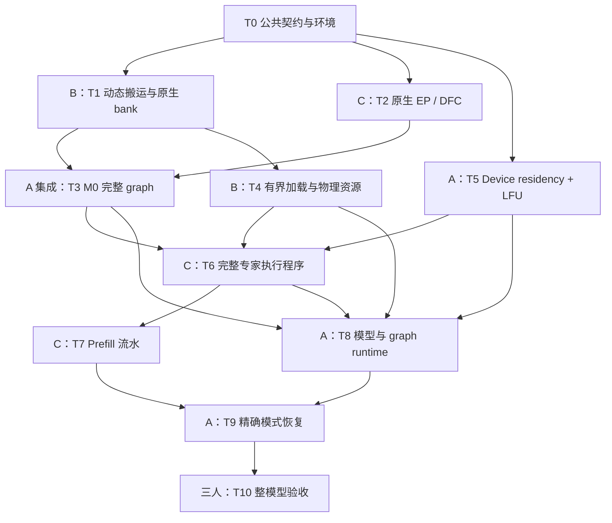

# MoE-Offload 三人开发分工与任务计划

更新日期：2026-10-20  
适用分支：`moe-offload-proto-v1`  
实现基线：`65e5c53ebb`；文档基线：`8f415f44c6`

## 1. 当前状态与安排原则

当前已完成 owner、资源预算、lease、Tensor LFU、固定多轮 DFC 编排等公共框架，并通过 31 项 CPU 契约测试。具体 accelerator runtime 尚未实现，A5 双卡完整 graph 的 M0 验收尚未通过。

目标是 DeepSeek V4 Flash 原生权重、A5 多卡 TP + EP，并保持 CUDA/NPU 共享基础设施及接口。首版必须实现完整 decode graph；前三层 routed experts 与 shared experts 常驻，缓存容量按每 rank 可卸载专家数计算，允许跨层竞争。

本计划按“特性 owner 本人参与开发，团队共三人”安排。三条工作线分别是：

- **A：特性 owner——公共控制与集成。**
- **B：权重存储与传输。**
- **C：EP 与专家计算。**

Prefill 与 decode 共用底层存储、搬运和计算适配。各任务沿用已有框架扩展，避免重复建立缓存、内存池或独立生命周期。

优先级定义：

| 优先级 | 含义 |
| --- | --- |
| **P0** | 必须先消除的可行性风险，决定后续方案能否成立。 |
| **P1** | 首版完整交付必需，不能因优先级较低而从首版删除。 |
| **P2** | 正确性通过后的优化，按实测瓶颈安排。 |

## 2. 三人职责

| 人员 | 主责 | 主要代码落点 | 对其他人的交付 |
| --- | --- | --- | --- |
| **A：特性 owner** | 公共接口、device residency、LFU 接入、runtime 生命周期、模型与 graph 集成、最终验收 | `../interfaces.py`、`../owner.py`、`../state.py`、`../policy.py`，具体 `BoundMoERuntime` | 固定数据协议、执行计划、缓存更新事务、完整 runtime。 |
| **B：存储与传输** | 原生 FP4 bundle、pinned 加载、物理池、动态 H2D/D2D、传输事件与资源保活 | `../storage.py`、`transfer.py`，具体 `ExpertFormat`、`DeviceTransferOps` | runner 可使用的固定权重 bank，以及可信的完成依赖。 |
| **C：EP 与计算** | wave 路由、dispatch/combine、原生 F、执行 bank 绑定、prefill 双缓冲 | `../programs.py`，具体 `WaveDispatcher`、`LocalExpertProgram`，模型执行接入点 | 单层完整 MoE 执行程序及其正确性测试。 |

上述文件主要位于 `python/sglang/srt/offloading/moe/`；公共 `transfer.py` 位于上一级 `python/sglang/srt/offloading/`。

## 3. 任务清单、依赖与完成标准

| 编号 | 优先级 / 主责 | 任务 | 依赖 | 完成标准 |
| --- | --- | --- | --- | --- |
| **T0** | **P0 · A 主导，三人确认** | 固定首轮接口及测试环境：bundle/bank 布局、device plan 字段、wave 输入输出、stream/event 责任；准备 A5 双卡和原生权重基线。 | 无。 | 三人可独立编写实现和测试，不必猜测 layout、mask 或完成语义。 |
| **T1** | **P0 · B** | 原生 bundle 写入固定 bank；实现最小图内动态选源搬运，覆盖 HOST、HOT_SLOT、无效项。 | T0。 | 同一 graph 使用变化的 device plan，正确搬入权重及 scales；地址稳定、容量有界。 |
| **T2** | **P0 · C** | 用常驻原生权重验证双卡 EP 多轮 DFC；完成 wave mask、激活布局转换、原生 F 和 combine。 | T0。 | 对齐常驻基线；尾波、空波、两 rank 非对称需求正确；通信顺序一致并可捕图。 |
| **T3** | **P0 · A 集成，B/C 支持** | 将 T1、T2 接成 M0 最小完整 graph，包含最小 hit/miss 规划和读写保护。 | T1、T2。 | 同一 graph 反复改变路由，动态搬运、EP、F、combine 全部正确；无 CPU 路由决策。 |
| **T4** | **P1 · B** | 有界 checkpoint 加载、原生格式整理、pinned store、热池与执行池分配、物理内存申报。 | T1；完整验收在 T3 后。 | 初始化不先占用全量 routed HBM；实际分配符合预算；无隐藏权重副本；加载失败安全清理。 |
| **T5** | **P1 · A** | 实现设备侧 `ResidencyOps`，接入已有 LFU：需求统计、hit/miss 计划、跨层热集合更新、generation 和提交保护。 | T0 后可独立开发；真实换入联调依赖 T1/T4。 | 与 CPU 参考一致；miss 可累计热度；临时执行不直接准入；连续 replay 正确改变热集合。 |
| **T6** | **P1 · C** | 实现完整 `LocalExpertProgram`：hit D2D/miss H2D、bank 就绪等待、F、读者完成；接入固定 DFC waves。 | T1、T2、T4；动态缓存联调接 T5。 | 执行容量小于本地专家数仍正确；不覆盖未读完 bank；shared expert 和公共尾处理只执行一次。 |
| **T7** | **P1 · C** | Prefill 全专家流式预取及双缓冲；layer-start 提前预取，router 后分波执行，复用 owner 提供的热池视图。 | T4、T6。 | 覆盖所有本地专家；load/compute 可流水；无未申报 buffer；prefill 不更新热度。 |
| **T8** | **P1 · A，B/C 提供组件** | 完成正式 runtime、模型 hooks、NPU graph 接入、step begin/end、graph lease、完成事件和异常关闭。 | T3–T6。 | 每次 forward 恰好更新一次；各 bucket 正确保活；warmup/capture 不污染热度或热布局；失败后安全排空。 |
| **T9** | **P1 · A** | 精确模式切换：快照、借池、连续 prefill、原 slot 重载、元数据及 LFU 恢复。 | T5、T7、T8。 | 反复交替后原布局及策略状态精确恢复，既有 decode graph 可继续使用。 |
| **T10** | **P1 · A 验收，三人负责各自回归** | 整模型 TP + EP、多 bucket、padding/适用 IDLE、长时间运行、CUDA 公共契约及旧 V2 回归；形成指标报告。 | T4–T9。 | 完成 M5；正确性、峰值内存、H2D/D2D 流量、命中率、端到端延迟有可复现结果。 |
| **T11** | **P2 · 按瓶颈分配** | 减少 hit D2D、复用临时副本晋升、降低通信轮数、融合搬运与 F/DFC、更复杂策略。 | T10 或已通过的稳定子路径。 | 对照基线有收益，且不破坏公共接口、完整 graph 和预算约束。 |

**M0 的范围：**T3 可以使用固定热集合，暂不接入完整 LFU；但需求、miss 和源选择必须随 replay 改变。不能通过每轮重新捕图或 CPU 决策来满足验收。

## 4. 任务依赖图

下面表示完整联调依赖。Mermaid 图可在支持 Mermaid 的 Markdown 阅读器或代码托管页面中渲染。

**关键路径：T1/T2 → T3。** 动态搬运和 EP graph 必须先证明能组合工作。

准备工作可以并行，不必等待全部前置任务验收：

- T5 可先用合成需求和测试传输实现验证设备状态与 LFU。
- T6 可先用固定热布局开发，随后接入 T5 的动态缓存。
- T8 可先准备模型安装、销毁和 graph bucket 接入，再绑定真实后端。
- M0–M5 的正式验收按顺序推进，提前完成某个接口不等于该里程碑已通过。

## 5. 第一轮分工

| 人员 | 第一轮可直接领取的工作 | 交付物 |
| --- | --- | --- |
| **A** | 完成 T0，建立 T3 集成测试骨架及正确性断言；随后开始 T5 设备状态和参考算法差分测试。 | 数据契约、最小集成测试骨架、缓存状态测试。 |
| **B** | 完成 T1：固定目标 bank、变化 device plan、同一 graph replay 的原生专家搬运。 | 独立可运行的动态传输测试与实现。 |
| **C** | 完成 T2：常驻原生权重、双卡 EP、多轮 DFC、同一 graph replay。 | 独立可运行的单层 EP/计算测试与实现。 |

B/C 两条路径通过后，由 A 组合成 T3；遇到图内动态传输、原生格式或 EP 捕图问题，优先共同处理，不将其推迟到整模型集成阶段。

## 6. 交界责任与协作规则

| 交界 | 责任划分 |
| --- | --- |
| `prepare_layer()` 与 `finalize()` | B 实现加载和资源构建组件；A 负责最终 `MoEBackend` 组装及 runtime 创建。 |
| 写入前等待旧读者 | C 提供计算的 `read_done`；B 的搬运实现遵守该依赖；A 的 residency 禁止生成不安全的覆盖计划。 |
| 搬运完成 | B 保证 `weights_ready` 覆盖完整 bundle；A 才能发布新映射；C 才能执行 F。 |
| Step 完成 | A 汇合 B/C 的完成依赖，产生覆盖计算、搬运、通信及预取的 `resources_idle`。 |
| 精确恢复 | A 决定恢复哪些 key、slot 和策略状态；B 执行原 slot 重载；C 释放 prefill bank 使用权。 |
| 公共接口变更 | A 维护 `../interfaces.py` 和公共状态协议；B/C 在各自后端文件开发，接口变化共同评审。 |
| CUDA/NPU 共用 | 公共控制逻辑保持设备无关；布局、传输、事件和计算差异由各职责线的后端实现承担。 |

任何实现都不得绕过 owner 私建权重缓存或隐藏 staging。普通 PyTorch copy、device 发起传输或融合算子使用相同资源与完成契约；首轮只需打通一种满足完整 graph 的实现。

## 7. 里程碑映射与测试分担

| 里程碑 | 对应任务 | 验收重点 |
| --- | --- | --- |
| **M0：最小技术闭环** | T0–T3 | 原生权重、动态搬运、双卡 EP 共同进入同一 graph。 |
| **M1：共享底座与所有权** | T4，配合 T8 的资源生命周期 | 有界加载、真实预算、传输保护、失败清理及旧 V2 回归。 |
| **M2：单层执行程序** | T6、T7 | 多轮 DFC、decode hit/miss、prefill 全专家预取与双缓冲。 |
| **M3：策略与跨层 LFU** | T5，配合 T8 | 设备侧缓存事务、跨层竞争、连续 replay 状态正确。 |
| **M4：模式切换与恢复** | T8、T9 | 精确布局及 LFU 恢复，各 graph bucket 生命周期正确。 |
| **M5：整模型交付** | T10 | 原生模型端到端正确、CUDA 公共契约回归及内存/流量/性能报告。 |

测试随组件开发，避免全部集中到特性 owner：

- **A**：缓存状态、LFU、graph、模式切换及最终验收。
- **B**：内存、原生权重搬运、资源保活和生命周期故障测试。
- **C**：数值等价、EP、多轮 DFC、prefill 与执行流水测试。

排期按上述交付件及验收结果推进。动态 H2D、原生 FP4 bank 和 EP graph 的风险尚未消除，暂不把 M0 之后的工作承诺为固定工期。

## 8. 更新记录

| 日期 | 变更 |
| --- | --- |
| 2026-10-20 | 基于现有框架状态建立三人分工、T0–T11 任务清单、优先级、依赖关系、第一轮交付及 M0–M5 验收映射。本文为开发计划，不改变代码实现状态。 |
