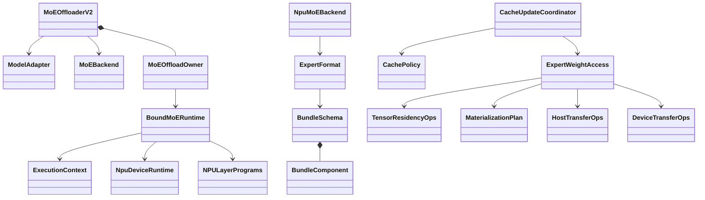

# MoE offload framework

English | [中文](README.zh-CN.md)

Updated 2026-10-25. The implementation now has one residency and execution stack.
See the [simplification record](SIMPLIFICATION_20261025.zh-CN.md),
[earlier refactor record](REFACTOR_20261025.zh-CN.md), [cache contract](CACHE_IMPLEMENTATION.zh-CN.md),
[H2D contract](H2D_IMPLEMENTATION.zh-CN.md), and [Ascend startup guide](../npu/doc/README.zh-CN.md).
Historical design documents describe earlier revisions, not the current API.

The native entry supports DeepSeek V4 FP4 and ModelSlim W8A8 expert bundles.
Full decode graph includes dynamic routing, transfers, and cache maintenance;
eager decode fallback is rejected. CPU contract tests do not certify NPU streams,
full graphs, numerical parity, or performance. Those hardware gates remain open.

## Entry points and extension boundaries

Inject `MoEOffloaderV2(config, backend, adapter=..., policy=...)` into ModelRunner,
or use the Ascend `--moe-offload-config` JSON entry. Ordinary V1/V2/Noop selection
remains available when MoE offload is disabled. Module and MoE offload cannot own
the same routed weights.

| Extension | Current contract |
| --- | --- |
| Model | `ModelAdapter` / `DeepSeekV4Adapter` in [models.py](../models.py): topology, expert ownership and reversible `ModelEntryBinding`. |
| Quantization format | `ExpertFormat`, immutable `BundleSchema` and `BundleComponent` in [formats.py](../formats.py): checkpoint validation, bounded conversion and complete native banks. |
| Device | `MoEBackend` assembles device storage, event bindings and execution; `NpuMoEBackend` is the current native implementation. |
| Cache algorithm | `CachePolicy.observe(..., due_out)`, `select_hot_set(..., target_keys)`, `finish_step`, and `copy_state`; both LFU policies use this contract. |
| H2D | `HostTransferOps` and `DeviceTransferOps` bound directly by `ExpertWeightAccess`; native ACL for eager plans, MemFabric for device-selected graph plans. |

The current NPU assembly accepts one storage-compatible format arena and rejects
mixed formats/shapes/topologies before allocation. Multiple format arenas are an
extension boundary, not an implemented serving topology.

## One execution stack

- [owner.py](../owner.py) owns phase transitions, forward tokens, budgets and graph leases.
- [runtime.py](../runtime.py) owns reusable invocation lifetime, explicit retirement and persistent hot-state snapshots; [npu/runtime.py](../npu/runtime.py) binds native hooks and events.
- [residency.py](../residency.py) produces fixed device plans, protects readers, checks generations and publishes complete bundles.
- [execution.py](../execution.py), [programs.py](../programs.py) and [prefill.py](../prefill.py) compose weight access, one D / sliced F / one C, and one shared prefill A/B pipeline.
- [npu/format.py](../npu/format.py) supplies common `ExpertLayerStorage` and `ExpertBank`; FP4/W8A8 retain format-specific conversion behavior.
- [npu/transfer.py](../npu/transfer.py) shares immutable `MemFabricAddressCatalog` tables while retaining independent mutable transfer scratch.

The duplicate `CacheBackend`, `CacheRuntime`, `CacheResidencyOps`, model binding
and Ascend adapter stack has been retired. The owner no longer has phase-controller
wrappers or duplicate slot lease managers. `NPULayerPrograms` holds the two phase-specific programs and their shared dispatch
layout without a runtime back-reference. `MaterializationPlan` is the common data
contract for execution fills and cache updates. Decode planner readiness always
covers the preceding compute frontier; no optional dependency flag remains.

## Cache and lifetime rules

`target_keys[K]` is the only logical hot-set output: distinct keys, -1 padding,
and no physical slot ordering. Survivors keep their slots. New bundles are copied
before publication; transient execution misses do not implicitly enter the cache.
Counts represent valid local post-dispatch assignments, including hits and misses.

The caller preallocates a separate device bool `due_out`. Policy observation
advances only valid decode steps, and clearing private policy state in `finish_step`
does not clear this transaction gate. Residency latches due together with the
runtime guard. Periodic LFU keeps the layer quotas selected by offline Top-K;
ordinary LFU may compete across layers. The runtime reads neither private config
nor a host mirror of the device clock.

Full decode graph currently uses a masked maintenance tail. Non-due transactions
are gated, but fixed selection/planning nodes can still execute. Device conditional
execution or fused early return has not been established by hardware validation.

`retain` pins resources; `register_completion` explicitly records dependencies.
Only proven stream frontiers permit redundant-wait elimination. The owner joins
previous `resources_idle` on-device before resource reuse. Prefill stops and joins
workers before sealing; bank overwrite waits for all previous readers across layers
and invocations. Failure retains partially submitted resources until drain succeeds.

Phase snapshots hold hot maps, validity, generations and policy state. Returning
to decode reloads the original slots; execution metadata and per-step counts reset.
Capture resources survive until successful graph destruction. Replay completion
uses fresh events. Cleanup stops submissions and workers before draining devices
and resetting graphs; retirement does not rely on cyclic GC.

Physical memory is counted once by allocation identity. Shared address tables and
bank views do not multiply allocations; writable scratch remains independent.
All complete expert components and native padding count toward their budgets.

## Validation

CPU tests are present under `test/registered/unit/offloading/`; they exercise the
production planner and assembly using test-only native boundaries. See the
[documented runner](../npu/doc/PERIODIC_CACHE_1022.zh-CN.md) and current
[validation record](SIMPLIFICATION_20261025.zh-CN.md).

Target hardware acceptance must cover ACL queue ordering, MemFabric dynamic
addresses, native formats, numerical parity, multi-rank EP, empty ranks, repeated
multi-bucket graph replay, phase restore, memory peaks, and H2D/F timelines.
