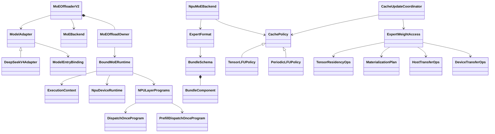

# MoE 权重 Offload 框架

中文 | [English](README.md)

2026-10-25：当前代码只保留一套缓存驻留与执行运行栈。重构原因、迁移映射及验证记录见
[精简记录](SIMPLIFICATION_20261025.zh-CN.md) 与[前一轮重构记录](REFACTOR_20261025.zh-CN.md)。[缓存契约](CACHE_IMPLEMENTATION.zh-CN.md)、
[H2D 契约](H2D_IMPLEMENTATION.zh-CN.md) 和 [Ascend 启动说明](../npu/doc/README.zh-CN.md)
描述当前实现；历史设计文档不再作为接口清单。

当前原生入口支持 DeepSeek V4 的 FP4 / ModelSlim W8A8 专家格式。完整 decode graph
包含动态路由、按需搬运和缓存更新；不提供 eager decode 回退。CPU 契约测试不能代替
目标 A5/CANN/torch_npu 的多流、完整图、数值和性能验收，本轮没有这些硬件结果。

## 入口与五个扩展维度

开发入口是 `MoEOffloaderV2(config, backend, adapter=..., policy=...)`，作为显式
`moe_offloader` 传给 ModelRunner；Ascend JSON 入口为 `--moe-offload-config`。
未启用时保留普通 V1/V2/Noop offloader 选择，模块 offload 与 MoE offload 不共同拥有专家权重。

| 扩展维度 | 当前职责与边界 |
| --- | --- |
| 模型 | [models.py](../models.py) 的 `ModelAdapter` 描述层、EP 所有权和模型入口；`DeepSeekV4Adapter` 是当前实现。`ModelEntryBinding` 安装/回滚/恢复模型入口。 |
| 量化格式 | [formats.py](../formats.py) 的 `BundleSchema` / `BundleComponent` 描述完整 bundle；`ExpertFormat` 承担 checkpoint 校验、有界转换和 bank 分配。FP4/W8A8 共用 storage 实现。 |
| device 后端 | `MoEBackend` 装配物理资源、device 事件和原生执行；`NpuMoEBackend` 是当前原生实现，其他设备继续使用公共生命周期协议。 |
| cache 算法 | `CachePolicy.observe(..., due_out)`、`select_hot_set(..., target_keys)`、`finish_step`、`copy_state`；`TensorLFUPolicy` 与 `PeriodicLFUPolicy` 使用相同契约。 |
| H2D 接口 | `HostTransferOps` / `DeviceTransferOps` 由 `ExpertWeightAccess` 直接绑定。ACL 用于 eager host 计划，MemFabric 用于 full graph 设备计划。 |

五个维度独立扩展不表示任意组合已实现。当前 NPU backend 只有一个兼容格式 arena，
在分配前拒绝不一致的格式/shape/EP 拓扑；混合格式多 arena 路由尚未实现。

## 唯一运行栈与源文件

| 文件 | 当前职责 |
| --- | --- |
| [offloader.py](../offloader.py)、[models.py](../models.py) | 模型注册、构造期接管、finalize、可恢复入口绑定。 |
| [config.py](../config.py)、[formats.py](../formats.py) | 专家身份/容量配置与原生 bundle 数据契约。 |
| [owner.py](../owner.py) | 唯一 phase/forward/graph 所有者、预算和失败状态；通过 `switch_phase` 切换。 |
| [runtime.py](../runtime.py) | `ExecutionContext`、`BoundMoERuntime` 和持久热状态快照；共用运行流程，设备事件/流/排空由注入的 device runtime 提供。 |
| [graph.py](../graph.py) | 图 lease、capture 保活、先停止提交/排空再销毁与退休。 |
| [residency.py](../residency.py)、[state.py](../state.py) | 设备计划、slot 映射、generation、validity、reader 保护和事务发布。 |
| [policy.py](../policy.py)、[periodic_lfu.py](../periodic_lfu.py)、[cache_metadata.py](../cache_metadata.py) | 策略私有状态及 assignment 统计；runtime 不读取私有策略 config。 |
| [execution.py](../execution.py)、[programs.py](../programs.py)、[prefill.py](../prefill.py) | 权重 lease、缓存尾部、D/F/C 编排和单一共享 A/B pipeline。 |
| [storage.py](../storage.py)、[resources.py](../resources.py) | 不可变 host master、registration 和去重后的物理字节账本。 |
| [npu/](../npu/doc/README.zh-CN.md) | 原生格式、传输、EP/FFN、装配和设备 hooks。 |

旧 `CacheBackend` / `CacheRuntime` / `CacheResidencyOps` 及其 model binding、Ascend adapter
已退休。`PrefillController` / `DecodeController` 和 owner 的重复 slot lease managers
不再参与运行；模式由 owner 管理，实际驻留安全由生产 planner 和完成依赖保证。

## 缓存、调度与内存约束

`target_keys[K]` 只表示唯一逻辑热集合，空位为 -1；其位置不表示物理 slot。
Residency 保留幸存者原 slot，失效 victim，搬运完整 bundle，最后发布映射及 generation。
临时执行区的 miss 不会自动准入热池。统计来自 post-dispatch 本地有效 assignment，
包含 hit/miss；不能用 Router 本地 top-k 代替接收需求，也不能把 assignment 命中率当字节节省率。

每次有效完整 decode 在设备上推进策略；调用方预分配独立 bool 标量 `due_out`。
`finish_step` 清理策略私有周期标志不影响该输出；planner 将 due 与 runtime 的
`update_enabled` 结合并锁存。capture/warmup、prefill 和全局空步不推进周期。
默认 periodic 策略和普通 LFU 都允许本 EP rank 内的可卸载层跨层竞争热 slot。
离线 Top-K 只决定初始驻留集合，不固定各层在线配额。

周期策略为每个 bucket 捕获普通/维护两种 full graph。普通 batch 仅累计热度和周期，
维护 batch 在整模型尾部执行跨层选入/淘汰和更新事务；不会在每层 FFN 内排序维护。
host 根据有效 decode batch 的提交次数选图，计数跨 bucket 共用并在 prefill 中保持；
不通过 `.item()` / 事件查询读取设备 due 或专家热度。额外图存储纳入 workspace 预算；
双图的真实 A3 捕获/切换及性能仍需实机验证。

每个 arena 共用不可变地址目录，同一物理 destination view 共用地址表；会被覆写的
wave/tail scratch 保持独立。`AllocationLedger` 对物理分配去重，权重、metadata、workspace
分别预算。hot/execution slot 含完整原生分量和 padding，view 不重复计费。

## 生命周期

1. Owner 的 forward token 禁止并发使用固定资源；后续提交在设备流上等待前一
   `resources_idle`，普通路径不新增逐步 host synchronize。
2. `retain` 负责保活，`register_completion` 显式登记完成事实；仅有已证明顺序的
   同流 frontier 可合并。`MaterializationPlan.copy_dependencies` 必须覆盖前序计算与 reader；
   decode planner 统一承担该契约，不再通过可选字段决定是否补录依赖。
3. 共享 prefill pipeline 按 invocation/layer 管理 session。覆盖 A/B 前等待旧 reader；
   worker 必须停止并 join 后才能封闭 invocation。提交异常仍保留部分提交资源。
4. 首次进入 prefill 排空并保存 hot 映射/有效位/generation 与策略；切回 decode 按原 slot
   重载 bundle。execution 元数据和 step counts 是短期状态，恢复时清零，不作持久快照。
5. 图捕获保活持续到图成功销毁。replay 完成使用本次提交的新事件，不能复用 capture ticket。
   清理必须先阻止新提交并 join worker，再 drain device，成功 reset 图后才退休资源。
6. 发生部分提交、restore 或 device fault 后 owner 失败，禁止继续服务；排空/reset 失败时保留
   资源以便重试。显式退休不依赖循环 GC。

## 验证与支持边界

当前 CPU 测试位于 `test/registered/unit/offloading/`，覆盖生产组件装配、缓存策略、
设备计划、失败保活、graph lease 和格式。本次另行新增的六个测试文件已按后续要求删除。
运行方法见
[周期缓存说明](../npu/doc/PERIODIC_CACHE_1022.zh-CN.md)，本轮结果以[精简记录](SIMPLIFICATION_20261025.zh-CN.md)为准。

NPU 验收仍需真实 native ACL/MemFabric、NZ 格式与 FP4/W8A8 数值对照、多 rank EP、
空 rank/尾波、多 bucket 连续 replay、prefill/decode 切换、内存峰值和 H2D/F 时间线。
不支持项和启动参数以 [NPU 说明](../npu/doc/README.zh-CN.md) 为准。
