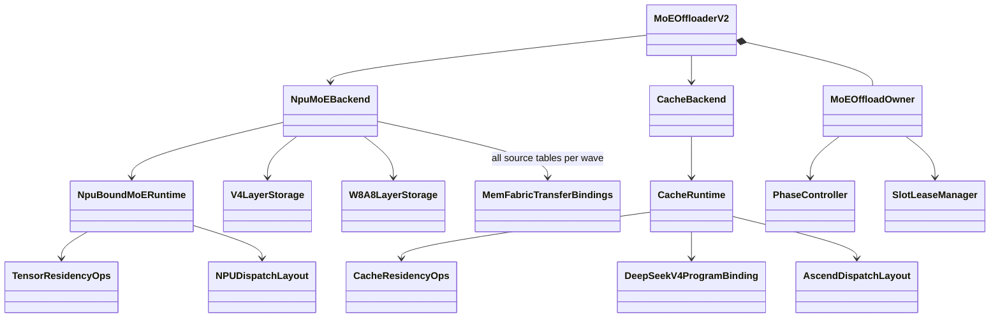
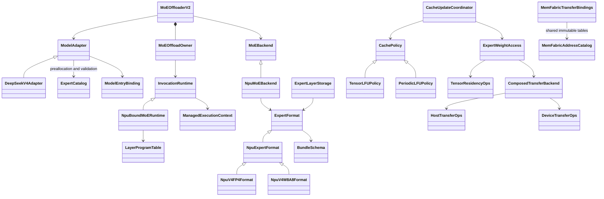
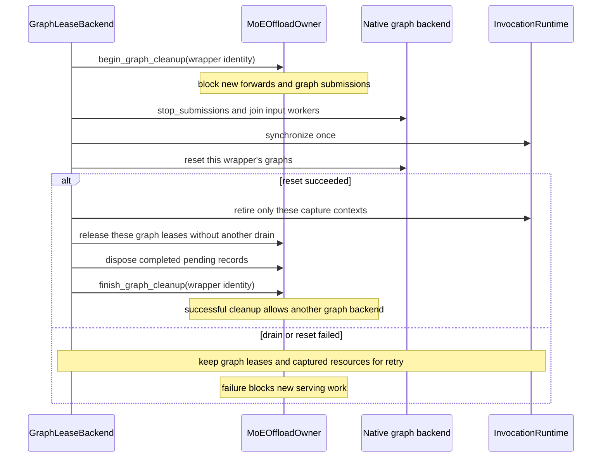

# MoE Offload 重构记录（2026-10-25）

基线：`feat/moe-offload-dev-1022` / `3392c01cb154f854dfa19981a9392459b3b0c5b4`。实现分支：
`codex/moe-offload-refactor`。本文记录对应此前《MoE Offload 重构设计》的 R01–R12，
描述实际实现、接口迁移和验证边界。当前接口入口见[框架说明](README.zh-CN.md)。

本轮完成设计中的结构重构 A–C：统一生产运行栈、显式生命周期、只读地址共享、模型与
量化数据契约，以及共享物理 bank 的 prefill 调度。阶段 D 仍保留设计允许的 masked tail
和独立可写 scratch；非 due 真早退、scratch 复用和设备融合优化需要独立硬件验收。
阶段 E 的新模型、新 device 和混合格式 arena 没有在本轮启用。

## 1 实现后的职责

五个必要变化维度保留独立协议，同时移除只有转发作用或重复维护不变量的实现。

| 维度 | 实际接口及实现 | 数据或行为边界 |
| --- | --- | --- |
| 模型 | [ModelAdapter](../models.py)、`DeepSeekV4Adapter`、`ModelEntryBinding` | `plan_model` 预先生成 `ExpertCatalog`；构造层再次核对同一拓扑；adapter 定位专家并声明直接调用入口。公共 binding 管 hook 安装、回滚和恢复。 |
| 量化 | [ExpertFormat / BundleSchema](../formats.py)、[公共 NPU format/storage](../npu/format.py) | schema 描述组件、shape/stride、dtype、物理字节、shard 和转换分组；FP4/W8A8 保留各自数值校验与转换 recipe。 |
| device | `MoEBackend`、`BoundMoERuntime`、`NpuMoEBackend`、`NpuBoundMoERuntime` | 后端提供分配、事件、流、原生执行与模型运行环境；公共 `InvocationRuntime` 管 invocation、transition、worker 和退休。 |
| cache | `CachePolicy.observe(..., due_out)` / `select_hot_set(..., target_keys)` / `finish_step` / `copy_state` | 算法拥有设备时钟与私有状态；runtime 只消费独立设备 due 和逻辑 key，不解释具体 policy 的 catalog/config。 |
| H2D | `HostTransferOps` / `DeviceTransferOps` / `ComposedTransferBackend` | eager prefill 使用 host plan 与 ACL；完整 decode graph 使用 device plan 与 MemFabric；完整 bundle readiness 后再发布。 |

`ExpertCatalog` 是唯一模型拓扑计划，缓存层索引、逻辑 key 前缀和专家总数；没有再加一层
内容相同的 `ModelPlan` wrapper。当前 NPU arena 仍要求同一物理格式和维度、统一 local
expert 数，构造期提前拒绝不兼容组合。

按 `python/sglang/srt/offloading/moe/**/*.py` 的物理行统计（含注释/docstring，不含测试与
Markdown），基线 33 个文件、9,521 行，当前 32 个文件、8,920 行，净减少 601 行。
主要收益是删除第二套不变量实现及加载状态机重复；该统计不表示性能或正确性收益。

`MoEOffloadOwner` 和 `InvocationRuntime` 保留两个有实际职责的对象：前者唯一持有预算、
phase、forward token、graph lease 与失败状态；后者持有设备 invocation、transition 和
资源退休。NPU 子类不再复制公共生命周期。这与设计中的 `OffloadRuntime` 职责收敛一致，
没有为名称一致新增转发 manager。

## 2 问题与改动映射

| 设计编号 | 已实现改动 | 主要位置及验证 |
| --- | --- | --- |
| R01 完成资源依赖 GC | lease、reservation、prefill session 保存 invocation ID；completion 与 context 共用一个可清空资源袋；成功查询、既有等待或对应图 reset 后显式退休；清除 batch、回调与强引用。 | [runtime.py](../runtime.py)、[execution.py](../execution.py)、[prefill.py](../prefill.py)；无 GC 弱引用及保留外部 context 测试。 |
| R02 每 wave 重建全模型地址表 | arena 级 `MemFabricAddressCatalog` 共享 host/hot 表；destination 按物理 view 缓存；seal 后拒绝新增表。区间验证改为有序区间扫描；账本仅计一次。 | [npu/transfer.py](../npu/transfer.py)、[npu/backend.py](../npu/backend.py)；真实 metadata 构造、storage identity、alias、seal、ledger 测试。 |
| R03 双缓存运行栈 | 删除 `cache_backend.py`、`cache_runtime.py`、`cache_residency.py`、`ascend_adapter.py`、`model_binding.py`；保留共享 `CacheRouteStats`；旧测试迁至实际装配/planner。 | [cache_metadata.py](../cache_metadata.py)、[residency.py](../residency.py)；第 6 节给出测试迁移。 |
| R04 保活隐式增加依赖 | `retain` 只保活；`register_completion` 登记依赖；join 去重相同事件，只展开精确的内建 aggregate，保留自定义子类语义。runtime 只合并自己记录且有顺序证明的同流 frontier。 | [runtime.py](../runtime.py)、[transfer.py](../../transfer.py)；重复事件、外部 reader、自定义 aggregate 和无查询 join 测试。 |
| R05 重复顺序边/drain | planner 标明 `plan_covers_compute_frontier`；publication ticket 覆盖完整 copied bundle；消费方省去可证明的同流等待。graph cleanup 一次停止提交/排空，内部 lease release 不重复 drain；close 统一 drained 入口。 | [execution.py](../execution.py)、[owner.py](../owner.py)、[graph.py](../graph.py)；capture 尾部 join、未知外部依赖和失败重试继续覆盖。 |
| R06 非更新步昂贵选择 | 引入调用方预分配的 bool `due_out`；策略清私有 due 后，事务仍使用锁存的显式门控。禁用时不推进统计/周期、不发布旧 targets。 | [periodic_lfu.py](../periodic_lfu.py)、[policy.py](../policy.py)、[execution.py](../execution.py)；masked tail 保留，尚未实现非 due 真早退。 |
| R07 模型/格式协议分散 | 模型计划、层校验和入口归 adapter；量化 resolver 只处理量化能力；FP4/W8A8 共用加载/完整性/seal 状态机与 bank；格式 recipe 独立。去掉 FusedMoE 构造中的重复验证调用。 | [models.py](../models.py)、[formats.py](../formats.py)、[npu/format.py](../npu/format.py)、[npu/format_resolver.py](../npu/format_resolver.py)。 |
| R08 无读者 target 副本 | 删除 `tail.target` 分配与每步 copy。 | [residency.py](../residency.py)；测试断言不再登记该 buffer。 |
| R09 snapshot 生命周期过长 | `HotSnapshot` 只含 key/slot、valid、generation；另存策略持久状态。恢复时 execution 无效化、step counts 清零；不恢复历史 `update_enabled`。 | [runtime.py](../runtime.py)；原位地址、hot 权重字节、slot/generation/周期精确恢复测试。 |
| R10 浅 controller/假租约 | 删除 owner 的 phase/prefill/decode controller 和未使用 host slot lease 副本；真实 slot reader 保护集中到 tensor residency。 | [owner.py](../owner.py)、[residency.py](../residency.py)。 |
| R11 加载状态残留 | seal 后清空 loaded/shard 临时状态和 raw views；参数 loader 替换为无闭包拒绝函数；close 只保留必要参数名。bank region owner 指向实际 tensor，避免 bank 自引用环。 | [npu/format.py](../npu/format.py)；重复 shard、并发 shard、partial repack、seal 后无 GC 回收和 close 测试。 |
| R12 死字段/遗留接口 | 删除 `_PrefillTarget.offset`、未用 `retain_registration`，以及只接受 DeepEP 的构造路径中不可达的 Ascend TP 分支。 | [npu/backend.py](../npu/backend.py)、[storage.py](../storage.py)、[npu/experts.py](../npu/experts.py)。 |

其他收敛：

- 一组物理 A/B bank 只装配一个 `BoundedPrefillWeightPipeline`，共享跨层及跨 forward reader
  历史。层和 invocation 是 session 数据；覆盖 bank 前等待真正最后 reader。
- phase 对应的 `LayerProgramTable` 在 finalize 时绑定，删除每次调用选择 phase、强引用
  runtime 的 `_LayerProgramMap`。`ComposedDFCProgram` 作为独立 D/F/C 策略保留，未构成第二套 serving stack。
- 启动注册、partial finalize、owner 构造及 model hook 安装失败自动进入 cleanup；drain
  失败保留 owner/runtime，允许显式 close 重试。
- 删除 A3 脚本中未使用的 `GRAPH_BS` 计算；清除并忽略 `kernel_meta/buildPidInfo.json`
  运行产物。实际 graph bucket 参数保持原值。

## 3 重构前后 UML

### 3.1 之前：重复运行栈与分散模型规则



### 3.2 之后：一个生产核心，五个扩展方向



图中的 access、coordinator 和 residency 分别负责搬运组合、graph tail 和设备事务；它们
保留现有有用协议，没有叠加只转发调用的 `ResidencyManager`。`V4LayerStorage`、
`W8A8LayerStorage`、`V4ExpertBank` 的旧导入名指向公共实现，未保留重复行为。

### 3.3 图资源清理



NPU graph backend 使用同一提交锁覆盖 capture、replay 与输入更新；先关闭提交门、停止并
join executor，再执行 drain。owner 的 cleanup token 区分多个 wrapper；清理 A 成功不
能成为 B 的 graph 已销毁证明。active forward 存在时直接拒绝 cleanup，避免 drain 与
仍在运行的 host submission 交错。capture session 另由 owner identity 门禁覆盖完整
进入、执行与 finally 退出过程，首次 graph lease 建立前也禁止关闭；失败先标记 FAILED
再撤销门禁。runtime 独立 close 及 drained close 都要求 host scope 已退出。

## 4 保持的运行语义

每 rank 的 host master 仍完整且不可变。hot 区保存执行副本，淘汰不做 D2H。逻辑 expert
key 与 slot 分离；存活 key 保留原 slot；valid/generation 和 sticky fault 继续保护复制
与发布。miss 的临时执行不自动准入热集。

Prefill 继续 eager，覆盖本层全部本地专家，保持一次 Dispatch、多波 FFN、一次 Combine。
Decode 继续完整 graph，按接收的有效本地 assignment 计数，不引入 Python `.item()` 决策、
eager decode 回退或下一波预取。shared expert、路由权重、激活、clamp、crop 与 reduction
仍由原执行 adapter 处理。capture 尾部 copy stream 的最后记录必须回到 origin stream。

FP4 的 cast 后 transpose、W8A8 的 transpose 后 cast 保留独立 recipe。native NZ 布局、
padding、scale 字节、完整 bundle 校验和 ACL 队列顺序没有简化为通用 reshape 或普通 copy。

## 5 同步与所有权验证要点

- event 去重只按同一完成事实；未知通信 reader 和自定义 completion 保留。仅由本 context
  recorder 记录的同流事件允许省去同流 wait，不能按设备名推断覆盖。
- `finish()` 封闭提交时要求临时域退出、worker 结束。资源退休不新增 serving host wait；
  利用已有 `done()`、phase wait 或 teardown drain 的结果清空保活对象。
- graph capture 的 context 与资源保持到对应 graph reset 成功；capture event 不能证明
  后续 replay 完成。每次 replay 外围重新记录 completion。
- 原生调用可能部分成功，资源在调用前保活；worker、event record、drain 或 graph reset
  失败均不得提前解除注册或释放目标。失败 cleanup 可以重试。
- 只读地址表共享；每个 wave/update 的可写 transfer scratch 独立。seal 之后拒绝新增
  destination table，避免 capture 地址与 ledger 在 finalize 后漂移。

## 6 测试迁移与结果

删除旧双栈的四个测试文件，共 57 个测试方法。相应不变量迁入保留的生产组件，另补真实
metadata、模型边界与无 GC 生命周期验证；不以旧实现作为新实现的 oracle。

| 退休测试 | 保留/新增覆盖位置 | 不再适用的内容 |
| --- | --- | --- |
| `test_cache_metadata.py`（13） | `test_cache_contracts.py`：assignment 守恒、空/禁用统计、无 host read；`test_npu_address_catalog.py`：物理计账 | 旧逐 token `LocalRoutes` histogram 接口 |
| `test_cache_runtime.py`（22） | `test_native_periodic_cache.py`、`test_npu_backend.py`、`test_tensor_residency.py`、`test_cache_contracts.py`：周期、hot 字节、DP idle、恢复与失败 | 旧 eager runtime 的周期编排与 ModelRunner 兼容路径；生产 eager decode 拒绝测试继续保留 |
| `test_cache_model_binding.py`（11） | `test_model_adapter.py`：另一模型结构、事务回滚、入口恢复；`test_moe_decode_workspace.py`/backend：padding、scale、empty | 旧 `DeepSeekV4ProgramBinding` 独立实现 |
| `test_cache_integration.py`（11） | `test_cache_contracts.py`：尾部一次更新、跨层/forward 共用 pipeline；tensor residency：publication、aux reader、活跃 bank；lifetime/graph：失败保活 | 第二条 serving 运行栈的专属装配 |

本轮最终验证：

| 检查 | 结果与环境 |
| --- | --- |
| offloading 核心 CPU 回归 | **202 项通过，0 failure / 0 error / 0 skip**；Python 3.9.6、CPU torch 2.8.0，使用下述 package shell 隔离完整服务初始化。 |
| 启动脚本 CPU 回归 | **17 项通过**；fake server/native builder，不加载模型。Bash process substitution 所需 `/dev/fd` 在沙箱外运行。 |
| Python 静态语法与格式 | 44 个新增/修改 Python 文件经 Python 3.13.2 AST 解析及 Black 检查通过。 |
| 差异及文档 | `git diff --check` 通过；10 份新增/同步文档的本地 Markdown 文件链接检查通过。 |
| NPU 实机 | 未执行；缺少目标设备、torch_npu 和 CANN。 |

仓库要求 Python >= 3.11；本地 CPU torch 只安装在 3.9 环境，所以上述 CPU 结果不等于
在受支持 Python/NPU 环境完成整包导入或 serving 验证。新增和修改源码另用 3.13 解析。
并发回归使用真实 Thread/Event 验证 capture 建 lease 前及 finally 退出中的关闭门禁；
图清理回归覆盖一个 wrapper reset 失败时另一个 wrapper 成功 cleanup 的资源隔离。

CPU 核心测试复现命令（在仓库根目录；系统 CPU torch 环境用 package shell 避开完整
`sglang.__init__` 对 GPU 栈的加载）：

```bash
PYTHONDONTWRITEBYTECODE=1 /usr/bin/python3 - <<'PY'
from pathlib import Path
import sys, types, unittest
root = Path.cwd()
pkg = types.ModuleType('sglang')
pkg.__path__ = [str(root / 'python/sglang')]
sys.modules['sglang'] = pkg
directory = root / 'test/registered/unit/offloading'
sys.path.insert(0, str(directory))
modules = sorted(p.stem for p in directory.glob('test_*.py')
                 if p.stem != 'test_launch_moe_offload_npu')
suite = unittest.TestSuite(unittest.defaultTestLoader.loadTestsFromName(m)
                           for m in modules)
result = unittest.TextTestRunner(verbosity=2).run(suite)
sys.exit(not result.wasSuccessful())
PY
```

Launcher 测试单独加载 `test_launch_moe_offload_npu`。它启动真实 Bash 脚本但使用 fake
server/native builder，验证参数、日志、退出码及 tracing 配置，未启动模型或 NPU。
测试的故障注入会输出预期的 capture/drain 异常日志；CPU trace 的 shape 分支警告不代表
NPU graph 已通过验证。

## 7 待硬件验收与后续独立优化

当前机器没有 torch_npu、CANN 或 Ascend，未执行真实 native 扩展编译、设备 full graph、
多 rank EP、FP4/W8A8 推理数值和性能对比。CPU 替身只能验证装配/数据/所有权契约。

| 目标环境验收 | 必须记录 |
| --- | --- |
| FP4 和 W8A8 checkpoint / repack / FFN | 模型、量化、CANN/驱动、native 布局、数值容差及普通 resident 对照 |
| 完整 decode graph | 多 bucket 连续 replay；全空/非空切换；hit/miss、fault/generation、周期边界；固定地址 |
| Prefill/decode 切换 | 多层全专家覆盖、A/B reader 时间线、精确 slot/权重/generation/策略恢复 |
| 故障与清理 | partial capture、drain/reset 失败、多个 graph wrapper、新建图、注册释放顺序 |
| 资源和性能 | host/hot/destination table 实际 metadata、峰值 HBM、capture 时间与节点数、H2D/F 重叠、端到端延迟分布 |

非 due 步仍可能执行排序/规划节点；本轮只把设备 due 变成明确契约，并保证禁用事务不
发布错误状态。要移除这些开销，需要经验证的设备条件子图或融合 kernel 真早退。
可写 scratch 复用也须先证明跨波、跨图、跨调用串行依赖；当前独立分配是有意保留。
本记录不将源码行数、CPU 操作计数或引用实验解释为 NPU 吞吐收益。
