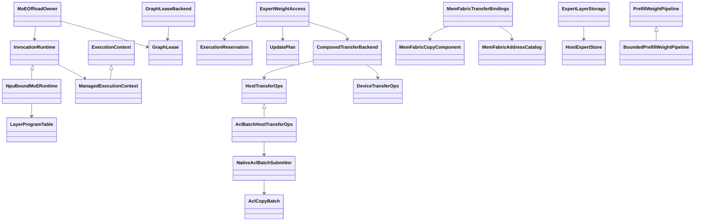
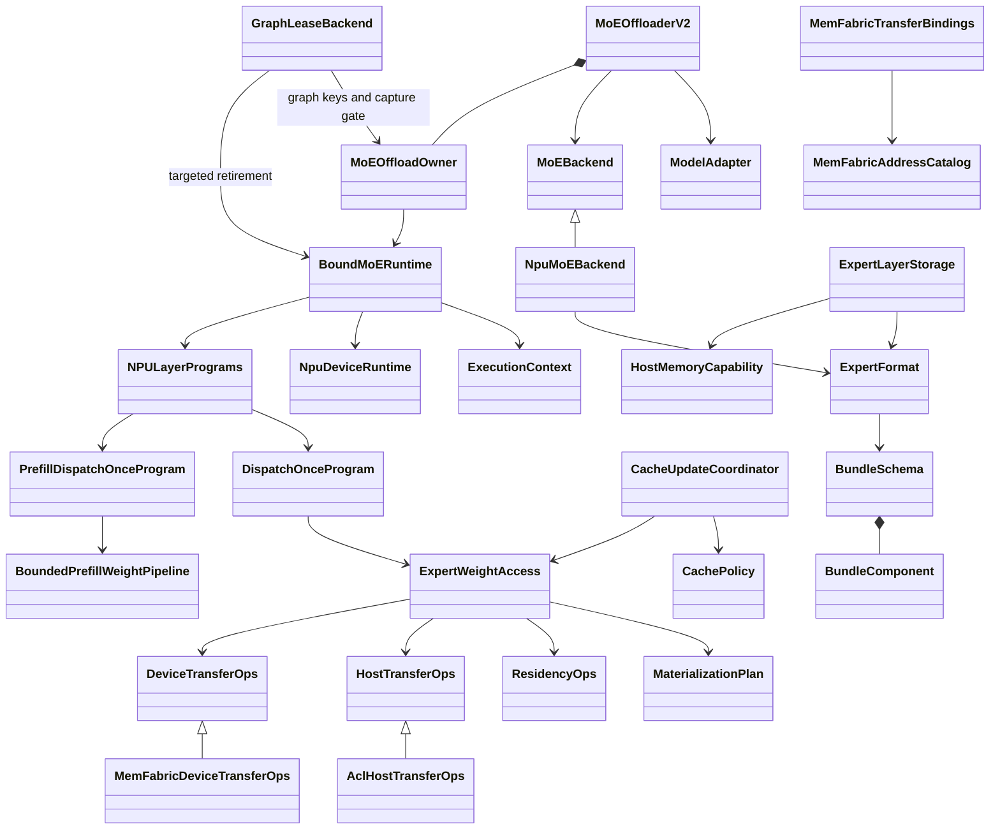

# MoE offload Python 实现精简记录

日期：2026-10-25。分支：`codex/moe-offload-refactor`。
实施起点：`de1dd2a2e57220132ac948a91b75e04b51e68bca`。
PR 行数基线：`8e7601ae4a48c1127afd1bcdccf0a0ad61dbf043`。

本轮落实“保留模型、量化、device、cache、H2D 扩展方向，加深主要抽象”的精简方案。
相对指定基线，生产 Python 的新增加删除从 **9,581 行降至 8,365 行**，减少
**1,216 行（12.7%）**。本次实现提交自身对生产 Python 净删除 1,210 行；两个数字
口径不同，前者比较最终两棵树相对共同基线的 diff，后者是本轮编辑的增删净额。

结果位于评估的 8,100–8,620 行范围内，**未达到 4,000 行**。本轮未删掉模型/量化
能力、错误处理和同步契约，也未将实现移出统计目录或转为 native 代码来降低数字。
CPU 回归通过；真实 NPU 数值、graph、内存峰值和性能仍待硬件验收。

## 1. 行数与范围

口径：`python/sglang/srt` 下本次 MoE offload 及集成的 51 个 `.py` 文件，相对指定
基线的 `added + deleted`，包含空行、注释，不累计中间提交。测试、Markdown、JSON、
启动脚本、C++/头文件不计入该数值。各组互不重叠。

| 文件组 | 实施前 | 实施后 | 减少 | 原评估范围 |
| --- | ---: | ---: | ---: | ---: |
| 生命周期/执行：runtime、owner、graph、execution、interfaces、npu/runtime | 2,398 | 1,950 | 448 | 1,950–2,100 |
| NPU 装配/传输/格式/存储及公共 transfer/formats/storage | 3,184 | 2,719 | 465 | 2,600–2,800 |
| 缓存/调度/计账/诊断 | 2,170 | 1,949 | 221 | 1,900–2,000 |
| 模型/FFN/配置/其余集成 | 1,829 | 1,747 | 82 | 1,650–1,720 |
| **合计** | **9,581** | **8,365** | **1,216** | **8,100–8,620** |

最后一组比估算上限多 27 行：保留模型绑定与失败恢复状态、独立构造入口的环境校验，
并补充精确 FFN bank 的组件宽度校验。整体仍在预算内；没有为单组预算删掉边界检查。

当前拆分为核心包 7,825 行、公共 transfer 187 行、其余集成 353 行。
总计新增 8,325 行、删除 40 行。复现方法：

```sh
git diff --numstat 8e7601ae4a48c1127afd1bcdccf0a0ad61dbf043 HEAD -- python/sglang/srt |
  awk '$3 ~ /\.py$/ { n++; a += $1; d += $2 } END { print "files=" n, "added=" a, "deleted=" d, "changed=" a+d }'
```

此记录所属提交应输出 `files=51 added=8325 deleted=40 changed=8365`。以后若混入其他功能，
必须重新归因文件与 diff，不能无条件沿用目录过滤。

## 2. 实际修改与位置

| 原问题及位置 | 本轮实现 | 保留的必要职责 |
| --- | --- | --- |
| [interfaces.py](../interfaces.py)、[runtime.py](../runtime.py)、[npu/runtime.py](../npu/runtime.py)：ABC、公共基类和单一子类重复表达运行流程 | 收敛为具体 `ExecutionContext` 和 `BoundMoERuntime`；NPU 文件仅保留设备流、事件、排空及内存原语 | `MoEBackend` 装配边界、device runtime 注入、模型 hooks、graph 资源、失败状态 |
| [execution.py](../execution.py)：两份相同计划结构、SourcePolicy 与 phase 重复、transfer 组合层只转发 | 统一 `MaterializationPlan`；`ExpertWeightAccess` 直接绑定 `host_ops` / `device_ops`；context 自己管理身份、保活和等待 | stage → 完整 bundle 发布 → 最后 reader 完成；HostCopyPlan/DeviceCopyPlan 保持不同契约 |
| [owner.py](../owner.py)、[graph.py](../graph.py)：GraphLease 对象及 transition ticket/list 反复传递 | wrapper 维护 graph key 集合；成功 drain/reset 后 owner 注销。transition 内完成等待和成功退休，不再往返持有 ticket | 整个 capture session 门禁、多 wrapper 定向退休、失败保活与重试；未取消 phase barrier |
| [prefill.py](../prefill.py)：实际只有一个 session 却使用字典；initial/grouped leases 两份集合 | 单 `_active_session`；worker join 后将微批 lease 列表转换为分组列表；移除无独立实现的 pipeline ABC | dispatch feedback、A/B/a 调度、worker join、partial-submit fence、abort 幂等 |
| [programs.py](../programs.py)、[resources.py](../resources.py)：未接入主路径的 repeated DFC、程序表和 slot lease manager | 删除 `ComposedDFCProgram`、`LayerProgramTable`、`SlotLeaseManager`；真实 D/F/C 与驻留协议继续负责执行 | 固定 decode waves、一次 dispatch/combine、设备 generation 与 reader 保护 |
| [state.py](../state.py)、[residency.py](../residency.py)：execution_key 只写不消费，重复 ge 和计账模板 | 删除冗余 key tensor；复用固定 scratch 的 fault 检查与 `tensor_allocations` | execution_valid、canonical error、完整发布、cache 选择和 due 门控 |
| [npu/transfer.py](../npu/transfer.py)：每个 binding 重复源组件与容量认证 | `MemFabricAddressCatalog` 持有唯一源 schema/owners；binding 只提供 destinations、容量和独立 scratch | 源注册、设备/容量、地址别名、generation/故障检查；封口后禁止新地址表 |
| [npu/native_acl.py](../npu/native_acl.py)、[transfer.py](../../transfer.py)：ACL 提交包装链，region 重复容量 | `AclHostTransferOps` 直接校验、lower、提交和保活；容量从 source/destination 能力对象推导 | SDK ABI probe、torch_npu host-queue 顺序、native descriptors、部分提交失败保活 |
| [npu/format.py](../npu/format.py)、[v4_format.py](../npu/v4_format.py)、[w8a8_format.py](../npu/w8a8_format.py)：重复 probe、layout 和字节映射 | `CheckpointComponent` recipe 驱动共用 probe；`BundleComponent` 唯一描述 checkpoint/native dtype、shape、stride、extent | FP4 cast→transpose、W8A8 transpose→cast、host/runtime scale 字节差异、workspace 峰值验证 |
| [storage.py](../storage.py)、[npu/format.py](../npu/format.py)：HostExpertStore 与 loader 两套生命周期 | common `ExpertLayerStorage` 唯一加载/封口/关闭状态；保留 `HostMemoryCapability` | host master、注册 owner、分片完整性、sealed 后禁止写入、失败清理 |
| [npu/experts.py](../npu/experts.py)：每次 F 重建 QuantInfo/切 validity、浅 combine 容器、重复字段 | bind 时构造精确 `NPUExpertBank`；移除默认 0 的 execution_start 与 for_width、薄 `_Combine`、层程序重复 runner/dispatcher 引用 | dtype/device/宽度检查、物理切片验证、empty/padding/reduction、通信 reader joins |
| [base.py](../../base.py)、[offloader.py](../offloader.py)、ModelRunner | 删除全链路空 eager_step_scope | forward/capture 真正生命周期作用域与模型入口恢复 |
| [utils/offloader.py](../../../utils/offloader.py) | 普通 CPU parameter offloader 恢复直接 `Tensor.to(..., non_blocking=True)`，删除无额外语义的 TorchTransferBackend | 原非阻塞参数复制行为 |

没有引入兼容别名或空转发类保留已删除接口。包内调用和现有测试均迁移到实际新入口；
`layers/moe/paged_experts` 中同名 `HostExpertStore` 属于另一套既有功能，本轮未改动。

## 3. 重构前后的 UML

实施前的主要重复关系：



实施后通过数据与实际资源所有者连接主干：



`NpuDeviceRuntime` 表示当前注入实现；后续设备实现相同的 stream/event/drain/memory
方法即可复用公共 runtime。量化 recipe 只描述加载与布局元数据，不在 decode 热路径
解释 DSL。`CachePolicy` 继续只输出逻辑 keys 与 due，驻留 planner 不依赖具体策略字段。

## 4. 同步与生命周期约束

- `MaterializationPlan.copy_dependencies` 强制覆盖计划、旧目标 reader、源 readiness。
  decode planner 先 join reader 再记录 compute frontier，不再使用可选
  `plan_covers_compute_frontier` 和访问层补事件的分叉。
- `retain` 只负责保活；`register_completion` 负责依赖。以 recorder 确认的 stream 来源
  合并 frontier；未知 transfer/aux reader 完成事件仍独立等待。completion 弱引用 context，
  退休时原地清空同一资源袋，外部持有 completion 不会保留第二份 keepalive 集合。
- 一次成功 phase transition 在自身作用域内等待并退休。失败 context 留在 runtime，
  只有设备排空成功后才可释放。snapshot 仍只保存持久 maps、validity、generation 和 policy。
- prefill worker 退出并 join 后才能合并微批 lease 或记录失败 fence。合并失败保留原列表；
  部分提交即使没有返回 lease，也保留提交前记录的资源。abort 历史只服务失败调用的
  幂等与禁止重启，随 runtime/pipeline 关闭释放。
- capture 尾部 copy 必须回接 origin stream。首次 graph key 创建前及 capture finally
  期间仍有门禁；成功 reset 当前 wrapper 后才退休其 context/key，不影响其他 wrapper。
- 不共享可写 wave/tail scratch，不减少 host registration 生命周期，不移除格式 probe
  的同步 D2H 屏障，不增加正常 decode 的 host synchronize 或 CPU 路由判断。

删除的是多余表示与空接口；真正的发布前复制、覆盖前 reader、phase 排空和 graph 销毁
依赖仍在。此次没有据静态代码或 CPU 模拟结果宣称 NPU 时间线更快。

## 5. 与提案的取舍

保留 `ModelAdapter`、`ExpertFormat`/schema、device assembly、`CachePolicy`、两类 TransferOps。
新格式扩展其 recipe 与原生转换规则；新 device 提供物理资源及执行原语；新 cache 算法
继续输出 keys/due；新 H2D 实现各自的 host/device 提交契约。

环境检查集中到 `validate_native_environment`，但 backend 与独立 dispatcher 构造时
仍各自校验；没有添加只表示“已经校验”的包装对象。诊断的 host_buffer 注入继续用于
CPU 回归。模型 hook 回滚、O(1) catalog 索引、native host pool 注册释放保持原职责。

未实施以 accesses−hits 派生 misses、wave 计数覆盖、非 due 条件跳过排序、共享可写
scratch、重写 MemFabric lowering 或自定义融合 kernel。它们需要单独的算法等价性与
硬件证据，不能作为本轮 4,000 行目标的无条件收益。

## 6. 验证与边界

- 现存 offloading CPU 测试模块（不含 launcher）：**167 项通过**。
- launcher 使用真实 Bash 脚本及 fake Python/server/临时权重：**17 项通过**；沙箱
  最初禁止 `/dev/fd`，允许该测试命令后通过。没有启动真实模型服务。
- 新增回归放在现有文件，未恢复此前删除的六个独立测试文件。覆盖真实 pipeline 的
  worker 启动失败、部分提交失败、分组合并失败、abort 幂等；真实 address catalog 的
  指针共享/可写 scratch 隔离/封口；ACL 原生边界与失败保活；格式 probe 的额外复制拒绝；
  精确 bank 宽度；多 wrapper 定向退休、capture 门禁、transition 退休与 completion 来源。
- 所有本轮变更 Python 文件通过 AST 解析；局部 Black 格式检查和 `git diff --check`
  通过。静态检查未引入新的未定义变量或未使用导入；原生注册所需 torch_npu import
  保留其 `noqa` 标记，未顺带清理 ModelRunner 既有无关导入。

本地使用 macOS CPU Torch 2.8.0 / Python 3.9.6 的 package-shell runner，绕开完整 sglang
顶层初始化；仓库正式要求 Python ≥3.11。语法/格式另用 Python 3.13.2 检查。
因此以上是本机组件回归，不能替代受支持 Python 环境的整模型测试。

目标 A5/CANN/torch_npu 上仍需 FP4/W8A8 数值对齐、动态路由、multi-rank EP/空 rank、
不同 bucket 连续 replay、prefill/decode 精确恢复、native ACL host-queue 与 MemFabric
事件顺序、HBM/pinned-memory 峰值，以及相同负载下延迟/吞吐/H2D-F 时间线对照。
