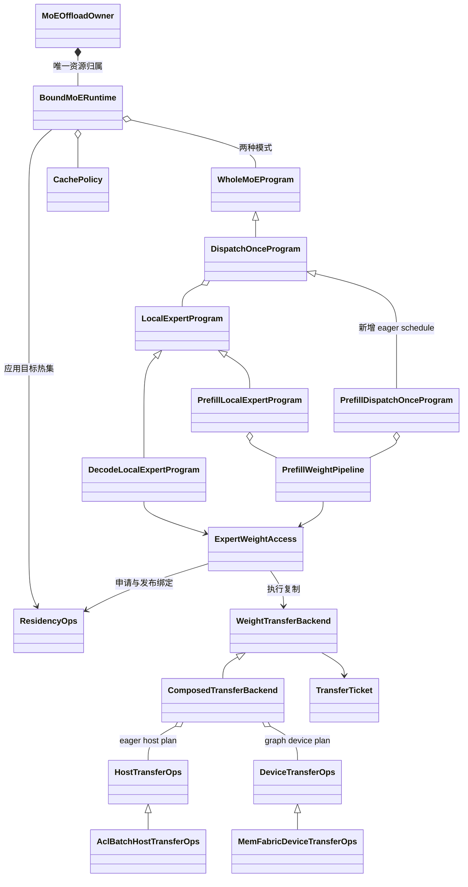

# MoE 权重 H2D 设计

> **历史设计快照**：正文保留当时方案与接口，其中重复缓存栈、phase controller、旧策略 API
> 已被后续实现替换，不应据此恢复旧模块。当前接口、迁移与验证状态见
> [2026-10-25 重构记录](REFACTOR_20261025.zh-CN.md)。

版本：v0.4 · 更新日期：2026 年 10 月 21 日 · 状态：公共抽象与组合程序已实现，设备后端与 A5 实机验收待完成。

本设计规定两条执行路径：prefill 使用 `aclrtMemcpyBatchAsync`，在 eager 模式下实现“层首预载大组、一次 Dispatch、多组 FFN、一次 Combine”；decode 使用 MemFabric 的 device 侧复制，在完整 graph replay 中处理动态专家需求。两条路径共享权重归属、完成凭据与读写保护，缓存算法不参与搬运调度。

对外沿用 **WholeMoEProgram 管执行、ResidencyOps 管驻留与占用** 的边界。框架接入方调用模型生命周期和 program；缓存接入方提供热度与热集策略。分片提交、线程、stream/event、MemFabric 指针表均封装在内部。

## 当前代码落地状态

v0.4 已实现公共接口和组合程序，设备后端仍需注入。代码包括：

- `transfer.py`：HostCopyRegion / HostCopyPlan / HostTransferOps / ComposedTransferBackend。
- `../execution.py`：ExecutionRequest / ExecutionReservation / UpdatePlan / WeightLease / LocalExecution，以及 ExpertWeightAccess、CacheUpdateCoordinator。
- `../interfaces.py`：ExecutionContext、ResidencyOps 的 publish_execution / finish_execution、WholeMoEProgram.layer_start、MoEDispatcher.dispatch_completion；BoundMoERuntime 的层首与尾部默认委托。
- `../prefill.py`：PrefillWeightPipeline 的 start / validate_session / seal / acquire / finish / abort 契约。acquire 负责当前组绑定及下一组预取，具体 worker 尚未实现。
- `../programs.py`：PrefillDispatchOnceProgram、PrefillLocalExpertProgram、DecodeLocalExpertProgram，复用 DispatchOnceProgram 公共循环。

`publish_execution` 和 `commit_update` 的实际接口均返回 TransferTicket，覆盖元数据发布完成；调用方不能拿复制完成代替映射发布完成。`LocalExecution.read_done` 同样是 TransferTicket。ExecutionContext.retain 在提交前保活资源，并将票据依赖纳入 resources_idle；record_compute_completion 在 decode 的复制前建立计算流 frontier，禁止下一 wave 复制与上一 wave FFN 重叠。

`ExpertWeightAccess.combine_prefill` 将首批多个微块的 lease 合并成一个大组 lease，绑定已经加载的连续视图，不再复制权重。FFN 完成后统一退休所有子 reservation；子 lease 转交后禁止单独消费或释放，避免 A 区域被提前复用。

以下设计中的公共扩展点已有对应代码；涉及 AclBatchHostTransferOps、MemFabricDeviceTransferOps、具体 prefetch worker 和设备驻留算子的部分仍是待实现契约。CPU 契约测试不等于 A5、真实 EP 或 graph 验收。

## 已确认的范围

| 项目 | 决定 |
| --- | --- |
| Prefill 搬运 | 使用 `aclrtMemcpyBatchAsync`，按 host 侧批量描述符直接写固定池 |
| Prefill graph | 不入图；允许 CPU 控制流、后台提交线程和 event query |
| 首批大小 | 每趟根据本趟 Dispatch 的设备完成反馈收尾，不在首趟测量后永久固定 |
| Decode 搬运 | 使用 `group_pack_copy`；源码以指定的本地 `memfabric_hybrid-master` 为参考，通过 `DeviceTransferOps` 接入 |
| Decode graph | 完整入图，动态命中、复制计划、热度及热集更新都不能依赖 replay 时执行 Python |
| 权重存储 | 每 rank 保存自身专家的完整、不可变 host 主副本；临时执行与热缓存更新分离 |
| 容量 | 热池按每 rank 可卸载专家总数乘 ratio 计量；离线跨层 Top-K 初始化，在线周期层内替换并保持每层配额（2026-10-22）；执行缓冲单独显式计量 |
| 模型范围 | DeepSeek V4 Flash 原生格式；前三层 routed 权重及 shared 权重均保持常驻 |
| Prefill 策略 | 遍历本层全部本地 routed 专家；不依据路由热度缩减 H2D，也不更新 LFU |
| 模式切换 | 进入 prefill 前备份 slot 布局、映射及策略状态；切回 decode 时按原 slot 恢复权重与状态 |
| 并发范围 | 一个 batch 的一次模型 forward 串行执行；允许该 forward 内复制与计算重叠 |
| 首版排除 | EPLB、在线权重更新、投机解码、MoE TP、并发 forward 与跨 forward 重叠 |

Tensor 可以继续作为存储与 FFN 绑定的载体，但本方案的 prefill 权重搬运不调用 `Tensor.to` 或 `Tensor.copy_`。ACL backend 取得经过验证的源、目标字节区间，直接写入 owner 的固定池，不新增专家权重副本。

## 现有代码与生长位置

SGLang 基线为分支 `moe-offload-proto-v1`，提交 `85beb8b16a90446e29caf78e6b340b1d2542b282`。以下“已有”表示接口或框架已经存在，不代表设备实现已经完成。

| 公共对象 | 保持的职责 | 扩展与后端接入 |
| --- | --- | --- |
| `MoEOffloadOwner`、两个模式 controller | 唯一资源 owner、模式切换、forward 串行化、graph lease | 继续使用；纳入 prefetch worker 与所有异步完成凭据 |
| `BoundMoERuntime` | 模型 hooks、资源绑定、step 首尾、snapshot/restore | 将层首 hook 接到 prefill program；统一收束后台任务 |
| `WholeMoEProgram` | 完整 routed MoE 的执行入口 | 增加可选 `layer_start` 生命周期入口，默认空操作 |
| `DispatchOnceProgram` | 一次 D、多组 F、一次 C 的公共流程 | 提取可覆盖的 wave schedule 获取点；默认仍用静态 waves |
| `LocalExpertProgram` | 单组权重就绪、FFN 与读结束保护 | 实现 prefill 流水版本和 decode graph 版本 |
| `DispatchLayoutAdapter` | 切出 wave 输入，按原接收行写回结果 | 支持 eager 的本趟 K；decode 保持固定容量、设备 mask/count |
| `ResidencyOps` | 执行计划、热集更新准备、提交映射 | 明确执行 reservation；增加临时绑定发布和 reader 结束接口 |
| `CachePolicy` | 热度更新、选择目标热集、状态复制 | 保持独立；LFU 是首个可替换实现 |
| `WeightTransferBackend` / `TorchTransferBackend` | 固定目标复制与公共 transfer 入口；已有 Torch 实现保留 | 新增 host plan 入口与组合实现；本方案不经过 Torch copy 路径 |
| `HostTransferOps`，已新增 | host 已知源、目标的批量搬运 | 具体实现 `AclBatchHostTransferOps`；与已有 device-plan 抽象并列 |
| `DeviceTransferOps` | 将设备计划转成可捕获的设备操作 | 新增具体实现 `MemFabricDeviceTransferOps`，无需另建同义抽象类 |
| `TransferTicket` / `Completion` | 表达复制完成及对象保活 | 两种后端共用；不把“已提交”当作“已完成” |
| `HostExpertStore`、`AllocationLedger`、`SlotLeaseManager` | host 主副本、唯一物理分配计量、图外区域占用 | 补映射内存能力验证；图内动态槽位仍由设备协议保护 |



新增 `ExpertWeightAccess` 是一个内部组合服务，负责把已有 residency 与 transfer 接起来，不拥有另一份权重池，也不成为新的缓存策略接口。prefill 的线程与流水状态仅属于 `PrefillWeightPipeline`。

## 对外接口与职责边界

### emit 的含义

`emit_*` 是本项目的命名约定，表示“组织并发出这一阶段的执行操作”，不是 PyTorch 的特殊关键字，也不是发送消息或广播事件。对于其中的设备操作：

- **Eager 执行**：调用方法时向 stream 提交操作，设备按依赖执行；方法返回不代表执行完成。
- **Graph capture**：调用方法生成被捕获的设备操作及依赖。
- **Graph replay**：执行已捕获的操作，不重新调用这些 Python 方法；动态选择必须留在设备状态和设备算子中。

前缀本身不承诺“所有逻辑都可入图”。例如 prefill 的 `emit_layer_start` 可以启动 host 预取 worker，因为 prefill 明确只走 eager；这段 host 逻辑不能被复用为 decode replay 的控制流。完成状态由 `Completion` / `TransferTicket` 表达，不能根据 `emit_*` 已返回来释放资源。

| 入口 | 调用时机 | 作用 |
| --- | --- | --- |
| `emit_step_begin` | 一次模型 forward 开始 | 准备本趟设备状态、清理本趟访问计数，并设置更新控制 |
| `emit_layer_start` | 本层 Attention / Router 之前 | Prefill 启动首批预取；decode 不启动权重预取；常驻层不进入 offload 流水 |
| `emit_after_router` | Router 之后 | 路由统计准备；不能替代 Dispatch 后的完整本地需求 |
| `emit_step_end` | 最后一层模型计算之后 | Decode 在图内更新热度、选择热集、搬运并提交驻留状态；prefill 不更新热度或热集 |

### 框架接入方

沿用 `BoundMoERuntime` 的生命周期入口，无需调用 `group_pack_copy` 或管理后台线程。

```python
# 结构示意；具体模型 hook 绑定由 runtime 完成。
with runtime.forward_scope(owner, batch):
    runtime.emit_step_begin(context)
    for layer in model_layers:
        runtime.emit_layer_start(layer.id, context)
        hidden, routing = layer.before_routed_moe(hidden)
        runtime.emit_after_router(layer.id, routing, context)
        hidden = selected_program.run(layer, hidden, routing, context)
    runtime.emit_step_end(context)
```

prefill 在普通 forward 中执行这些调用；decode 在 capture 时发出设备节点，replay 由图执行，不重跑以上 Python。前三层与 shared 专家仍由原常驻路径处理。

`emit_after_router` 可做路由统计准备，但 **EP 本地完整需求以 Dispatch 接收结果为准**。本 rank 不去加载其他 rank 的权重，不能用本 rank 的原始 token 路由代替所有发送 rank 汇入后的需求。

### Cache 接入方

替换缓存算法只需实现已有 `CachePolicy`：

- `update_statistics(...)`：按有效本地 token-expert 执行更新计数。
- `select_hot_set(...)`：产出固定容量的目标专家 key，未用位置填无效值。
- `copy_state(...)`：精确保存、恢复计数及其他策略状态。

策略不分配 slot、不启动 H2D、不操作 stream，也不因一次 miss 自动接纳专家。slot 分配由 `ResidencyOps` 处理；本分支周期 LFU 仅同层替换，热集变更在模型 forward 尾部统一执行。

### Decode 尾部热集更新的调用链

外部框架只调用 `runtime.emit_step_end(context)`。它是模型计算的尾部操作，必须包含在完整 decode graph 中，不能放成每次 replay 之后执行的 Python 缓存回调。runtime 内部组合已有接口：

```python
# 对应 CacheUpdateCoordinator 与 ExpertWeightAccess 的内部编排。
# 实现还会记录计算流 frontier，并保活计划、复制与发布完成凭据。
policy.update_statistics(policy_state, step_counts, update_enabled)
policy.select_hot_set(policy_state, residency_state.key_to_slot, target_keys)

update = residency_ops.prepare_update(target_keys, context)
for dependency in update.copy_dependencies:
    dependency.wait_on(context.copy_stream)

ticket = transfer_backend.materialize_into(
    update.copy_plan, update.bindings, context.copy_stream
)
residency_ops.commit_update(update, ticket, context)
```

`target_keys`、策略状态与复制计划均为预分配的设备张量。示意中的依赖列表是绑定时确定的结构；不能在 replay 时根据 miss 数量创建 Python 列表。大复制计划可在搬运实现内展开成固定数量的有界批次，返回的 ticket 汇合全部分量和批次。

| 步骤 | 决定什么 | 不允许提前做什么 |
| --- | --- | --- |
| `select_hot_set` | 目标缓存专家集合 | 不在这里分配 slot 或发起复制 |
| `prepare_update` | 保留幸存者、选择 victim、预留 slot/generation，形成复制与依赖计划 | 不能将待写入 slot 发布成新专家的命中 |
| `materialize_into` | 按计划将完整权重 bundle 写入预留目标 | 不能修改 LFU 或自行选择 admission |
| `commit_update` | 等待 ticket 后发布新的 key/slot/valid/generation | 不能仅凭复制提交成功就发布 |

例如原热集 `[A, B, C]` 变为 `[A, B, D]`：A、B 留在原 slot；C 的 slot 在旧 reader 完成后用于 D；D 的完整 bundle 就绪后才更新映射。本趟执行过的其他 miss 专家不会自动进入热集。

`commit_update` 必须在更新流上建立 weights-ready 依赖。runtime 将更新结果收束到 `residency_ready`，把所有后台工作收束到 `resources_idle`；跨流操作也必须正确接回 capture 图的完成路径。下一次 forward 不能越过前一次 residency-ready。对 replay 的 host 生命周期管理使用本次提交后的新完成凭据，不能复用 capture 时的 Python ticket 作为本次已完成证据。

### Prefill 层首预取的外部调用链

进入 prefill 的快照与借池由 owner / `forward_scope` 完成。对一层可卸载 routed MoE，模型接入方只负责放置以下调用：

```python
runtime.emit_layer_start(layer_id, context)  # 本层 Attention / Router 之前
hidden = attention_and_other_work(hidden)
routing = router(hidden)
runtime.emit_after_router(layer_id, routing, context)
output = runtime.prefill_program.run(layer, hidden, routing, context)
```

具体内部交接为：

```text
emit_layer_start
  -> prefill_program.layer_start          program 生命周期入口
  -> PrefillWeightPipeline.start          创建 session，开始 ACL batch 提交

prefill_program.run
  -> Dispatch
  -> dispatcher.dispatch_completion      取得真实设备完成凭据
  -> pipeline 观察完成后封口              停止新提交，冻结本趟 K
  -> 分组 FFN 与后续 H2D 双缓冲
  -> Combine
```

`layer_start` 为 WholeMoEProgram 提供默认空实现，prefill 派生 program 覆盖；pipeline 的具体方法见 `../prefill.py`。外部不传 K、不操作 copy stream、不等待首批 H2D，也不增加一个模型级“Dispatch 已结束”回调。Dispatch 已在 program 内执行，由 program 与 dispatcher adapter 完成反馈连接；设备是否可读权重仍由 ready 事件决定。

### Residency 与搬运适配方

下列签名展示已落地的公共契约；具体硬件方法体仍由 backend 实现。

```python
class ResidencyOps:
    def resolve_execution(self, request, context) -> ExecutionReservation: ...
    def publish_execution(self, reservation, weights_ready, context) -> TransferTicket: ...
    def finish_execution(self, reservation, read_done, context): ...       # 新增
    def prepare_update(self, target_keys, context) -> UpdatePlan: ...
    def commit_update(self, update_plan, weights_ready, context) -> TransferTicket: ...

class WeightTransferBackend:
    def materialize_host_into(self, plan, bindings, stream) -> TransferTicket: ...
    def materialize_into(self, plan, bindings, stream) -> TransferTicket: ...

class HostTransferOps:  # 新增；源与目标由 host plan 确定
    def materialize_into(self, plan, bindings, stream) -> TransferTicket: ...

class DeviceTransferOps:
    def materialize_into(self, plan, bindings, stream) -> TransferTicket: ...
```

`materialize_host_into` 是新的 host plan 入口。新增的薄组合类 `ComposedTransferBackend` 将它转交给 `HostTransferOps`，将已有 `materialize_into` 转交给 `DeviceTransferOps`，自身不管理缓存或分配权重。两个入口的差异是计划在 host 还是 device 上动态生成，不能偷偷 `.item()` 后把 device plan 转成 host plan。

兼容已有实现时，新增 host 入口可默认报“不支持”，不强迫所有既有 backend 立即实现；`supports_device_plans` 等已有能力属性继续保留。`RuntimeCapabilities.full_decode_graph` 只能由通过对应配套验收的 runtime 声明，不能仅因注入了一个 device ops 对象就设为真。

NPU 组合为 `AclBatchHostTransferOps + MemFabricDeviceTransferOps`；CUDA 可提供自己的两个实现。通用流水与 ResidencyOps 不含 `if npu/cuda` 分支，也不要求 CUDA 实现 ACL/MemFabric API。现有 `TorchTransferBackend` 继续服务原使用方，不是本方案的 prefill fallback。

| 类型 | 必须表达的内容 |
| --- | --- |
| `ExecutionRequest` | 本地专家 key 或范围、目标 bank、执行模式、来源策略；prefill 固定为 `HOST_ONLY` |
| `ExecutionReservation` | 目标绑定、复制计划、来源读取保护、目标写入保护、generation、复制前依赖 |
| `HostCopyPlan` | 有界的 host 侧复制描述符：源/目标存储引用、偏移、长度和容量；完整专家 bundle 的所有分量 |
| `DeviceCopyPlan`，已有 | 固定地址的 source_kind、source_index、destination_slot、valid、expected_generation、count，及静态 capacity |
| `WeightLease` | reservation、FFN bindings、`TransferTicket`；只表示执行占用，不表示热缓存接纳 |

内部组合服务只做三件事：

```python
lease = access.stage(request, context)
# resolve_execution -> 建立旧 reader 依赖 -> backend copy -> publish_execution

bindings = access.wait_ready(lease, compute_stream)
# 入队等待；不做全设备同步，也不由 host 判断 decode miss

access.release_after(lease, read_done, context)
# finish_execution；不在 Python 函数返回时立即释放 bank
```

`publish_execution` 只发布临时执行绑定；`commit_update` 才修改规范热缓存映射。两者都必须在完整 bundle 的 `weights_ready` 之后生效。图内方法中的 reservation 是固定张量位置的描述，动态有效性、generation 和选择均保存在设备状态中。

## Prefill 设计

### ACL batch 搬运后端

`AclBatchHostTransferOps` 将 `HostCopyPlan` 降低为 host 侧地址/长度数组，在 runtime 提供的 copy stream 上调用 `aclrtMemcpyBatchAsync`。每一项描述一个已排好格式的物理连续区间；一个专家可以贡献 W13、W2、scale 等多项，因此 `numBatches` 是复制区间数，不是专家数。

```text
HostCopyPlan
  -> 校验源/目标区间、容量、格式及注册能力
  -> 构造 srcs / dsts / sizes / destMaxs 与 location 属性
  -> 在 copy stream 建立目标旧 reader 的依赖
  -> aclrtMemcpyBatchAsync
  -> 同 stream 记录 batch_ready
  -> TransferTicket(batch_ready, 描述符与全部存储引用)
```

根据 [CANN 的 ACL batch 接口契约](https://www.hiascend.com/document/detail/en/CANNCommunityEdition/910/API/runtimeapi/aclcppdevg_03_1957.html)，适配必须满足：

- batch 内复制没有顺序保证；区间之间不能有读写依赖或重叠写。完整 batch 后的 event 才是该批权重的就绪凭据。
- 此接口支持 H2D 或 D2H；prefill 固定 H2D，不把 hot-slot D2D 混入这条路径。
- `sizes[i] <= destMaxs[i]`，并校验源实际可读范围；location 属性覆盖所有条目，属性起始索引合法且递增。
- 锁页 host 内存才具备所需异步行为。非锁页内存可能使调用等待传输完成，破坏层首提交与计算重叠。
- 返回成功不是设备执行完成；返回失败也不作为整批“原子回滚”的证据。保留已经使用的资源，排空相关 stream 后报告失败。

一个首批微块由 P 个完整专家组成，通常对应一次 ACL batch；若 SDK 条目上限要求拆成多次调用，须提交完整个微块后才增加 K，并合并它的完成凭据。反馈只停止后续微块，不能假定可以中断一个已下发的 batch。

接口存在不同 ABI：C 形式带 `failIndex`，部分 C++ 封装内部调用不带该参数的 V2。实现采用与目标 CANN 头文件编译匹配的薄 C++ 扩展，包装中统一错误码与诊断信息；不手工猜测 ctypes 结构布局或假定存在同名 PyACL 函数。版本差异只留在 `AclBatchHostTransferOps` 内。参见 [CANN C++ 封装](https://www.hiascend.com/doc_center/source/zh/CANNCommunityEdition/920beta2/API/runtimeapi/aclcppdevg_03_2227.html) 与 [batch 属性结构](https://www.hiascend.com/document/detail/en/CANNCommunityEdition/910/API/runtimeapi/aclcppdevg_03_1942.html)。

ACL 是字节复制，不会执行 dtype 转换、NZ/ND 转换或量化重排。复制范围由 `ExpertFormat` 的物理布局描述给出，包含必要的存储偏移与 padding；不能一律用逻辑 `numel * element_size` 代替。首次加载时完成格式准备，不在流水中偷偷分配中间权重。

### ACL 与 torch_npu 的队列接入

owner 继续拥有 device context、stream、event 和存储；ACL 扩展只借用这些对象，不另行初始化或销毁整套运行时。后台线程必须进入正确的 device/context，向指定 copy stream 提交。

需要同时保证两层顺序：**host 任务下发顺序**和 **device stream 执行顺序**。torch_npu 可能先把操作放入 host 任务队列；直接缓存一个 raw `aclrtStream` 后绕过该队列调用 ACL，可能使复制越过尚未实际下发的 `wait_event`。

建议薄 C++ 扩展通过目标版本支持的 torch_npu 提交机制，把“前置 wait → ACL batch → 完成 record”按序发到同一实际 stream。也可以使用经过验证的队列刷新边界，但刷新 host 下发队列不能退化为每批全设备同步。对已有 [ACL 双缓冲示例](/Users/yaobao/Documents/ChatGPT/moe-offload-ascend/examples/acl_h2d_double_buffer.py) 的 raw-stream 取句柄方式需重新验证；该示例使用单次 `memcpy_async`，不是 batch 后端实现。

描述符数组在异步回调和复制完成前保持存活，不保存 Python 局部临时数组的裸指针。扩展在安全持有对象引用后释放 GIL，避免 worker 的下发或轮询阻止主线程继续提交 Router/Dispatch。事件桥接、host 队列顺序及非默认 stream 都要作为独立集成用例验证。

### 内存布局

设本层每 rank 专家数为 N，首批预载上限为 `K_cap`，后续 FFN 分组大小为 S，首批提交微块大小为 P。

- **A**：容纳至多 `K_cap` 个完整专家的首批区域。
- **B**：容纳 S 个完整专家的后续区域，与 A 不重叠。
- **a**：A 内可容纳 S 个专家的别名视图，首批 FFN 结束后使用。

A/B 从 owner 已登记的热池借用区域与执行池中划出，实际物理容量不得超过二者总和。a 不增加物理容量。各分量按 `ExpertFormat` 的布局绑定；不能把格式不兼容或不连续的多个 slot 假装成单个连续 FFN 输入。

常规 N 大于 S 时要求 `1 <= P <= S <= K_cap <= N`，且 A、B 均有合法容量。N 很小时按 N 截断；只有一个分组时不启动无意义的第二组。预算不足以容纳必要的两组时，在初始化阶段报配置错误，不能临时分配未登记的权重缓冲。

### 每趟如何确定首批 K

“大组”是 FFN 的逻辑分组；其 H2D 由多个完整专家微块提交。这样才存在 Dispatch 反馈可以截断的提交边界。

1. `emit_layer_start` 调用 program 的 `layer_start`，创建带 `(forward_epoch, layer_id)` 的预取 session。worker 在 copy stream 上将 `[0, K_cap)` 按 P 分块写入 A。
2. worker 限制尚未完成的微块数量 Q；建议初始 Q=1，测量后再调整。不能一口气把整个 `K_cap` 都排进队列，再声称 Dispatch 可以截断它。
3. 主线程继续提交本层计算、Router、Dispatch。Dispatch adapter 提供覆盖真正接收完成的 `dispatch_ready`；仅有 Python 返回或通信已入队，不算完成。
4. 主线程把已 record 的 completion 发布给 session。worker 在微块边界 query；观察到完成后不再提交新微块。检查与提交之间有竞态，因此可能再进入一个微块，这一误差必须被 Q 和微块大小约束。
5. 一个微块的所有权重及量化分量必须成组提交。停止后在 copy stream 上 record `initial_ready`，将**已完整提交的专家数**冻结为 K，并向主线程发布 sealed 结果。
6. 主线程拿到 K 后构造本趟 waves；F0 等待 `initial_ready` 才读 A。K 包含收尾时仍在传输的完整微块，不把“已提交”误记为“已完成”。

若 Dispatch 很快完成，仍保证至少一个最小微块，使流水可启动；若先达到 `K_cap`，提前封口即可。所有 N 个专家最终都要加载，K 只决定前后两段的切分位置。

**这里没有取消已提交复制。** Event 表示依赖或可查询的完成状态，不会打断已下发的 ACL batch。反馈延迟由 query 周期、线程调度和在途微块共同决定；目标是尽量利用窗口，不承诺逐微秒填满窗口。

主线程为获取本趟 K，会等待 worker 的 sealed 结果，因此存在 Dispatch 完成后的 host 调度间隙。它无需等全部 H2D 在 host 上同步结束，但这种反馈本身并非零开销。P/Q 是可调参数，不改变每趟反馈的决定方式。

### 大组转小组双缓冲

```text
时间 ─────────────────────────────────────────────────────────────▶

计算流   Attention / Router / Dispatch │等 ready0│ F0(A,K) │ F1(B) │ F2(a) │ F3(B) │ C
                                      │          │        │       │
复制流   A: P0 → P1 → ... → 封口 → ready0 → G1→B │ G2→a  │ G3→B │ G4→a
                                      ↑                   ↑       ↑
                              Dispatch 完成反馈        等 read0  等 read1

F0 与 G1→B 重叠；F1 与 G2→a 重叠；之后 a/B 交替。
```

设 `ready_i` 为 Gi 完整 bundle 的复制完成，`read_i` 为 Fi 最后一次权重读取完成，必要依赖为：

```text
copy(G0 -> A)  -> ready0 -> F0(A) -> read0
copy(G1 -> B)  -> ready1 -> F1(B) -> read1
read0 -> copy(G2 -> a)   -> ready2 -> F2(a) -> read2
read1 -> copy(G3 -> B)   -> ready3 -> F3(B) -> read3
```

封口后，worker 交还 copy stream 的提交权；后续小组复制由 local program 调度。同一 session 不允许两个线程无序向该 stream 提交。计算 Gi 前预取 Gi+1，但仅等待目标 bank 的**上一代** reader；不能把等待未来 Fi 的操作插到供 Fi 使用的复制之前，造成循环依赖。

`read_done` 必须覆盖 FFN 使用权重的所有 stream。输入打包、FFN 输出写回的 scratch 另有消费依赖；不能因为权重读完就提前覆盖仍在 `write_wave` 中使用的激活缓冲。

### 与 DispatchOnceProgram 对接

当前 `DispatchOnceProgram.waves` 是构造时固定的 tuple，它的 `for wave` 本身不产生流水。为保持公共 D/F/C 实现，增加一个受保护的 schedule 获取点：

```python
# 公共骨架；默认 _wave_schedule 仍返回 self.waves。
dispatched = dispatcher.dispatch(hidden_states, routing, context)
layout = layout_adapter.bind(dispatched, context)
for wave in self._wave_schedule(layer, dispatched, layout, context):
    wave_input = layout_adapter.select_wave(layout, wave, context)
    local = local_program.run(layer, wave_input, wave, context)
    layout_adapter.write_wave(layout, wave, local, context)
combined = dispatcher.combine(layout_adapter.combine_input(layout, context), context)
return dispatcher.finish(combined, context)
```

新增 `PrefillDispatchOnceProgram` 覆盖 `_wave_schedule`：向 pipeline 传递 Dispatch completion，等待 sealed K，生成 `[0,K)`、`[K,K+S)`……。wave 继续使用已有 `ExpertWave`，首组 bank=A，后续 B/a 交替；每趟验证区间连续、无重叠且恰好覆盖 `[0,N)`。不要修改一个被其他调用或 graph 共享的 `self.waves`。

为此，dispatcher 需要实现已有的 `dispatch_completion(dispatched, context) -> Completion`，或由等价的 dispatch handle 适配器实现。若 Dispatch 使用独立通信流，须先建立真实通信完成依赖，再 record 对外的 completion，不能无条件在默认 stream 上放一个空事件。

`PrefillLocalExpertProgram.run` 内部负责“预取下一组 → 等当前组 ready → FFN → 记录 reader”。`DispatchLayoutAdapter` 负责动态 K 对应的行选择、专家分组信息及原行写回。一次 Combine 使用原 Dispatch handle 和路由权重，避免重复 top-k 加权。

各 EP rank 的 K 可不同，因为变化仅发生在本地 FFN 分组。D/C 的通信次数和顺序不变；前提是 FFN 分组内部不含要求各 rank 同步组数的 collective，首版 MoE TP 不支持。

### Prefetch session 生命周期

```text
CREATED -> LOADING_INITIAL -> SEALED -> STREAMING -> DRAINED
                    任意状态 -> FAILED -> 停止提交并排空
```

session 归 runtime 所有，仅保存视图、计划、event 和 worker 控制状态。worker 必须显式设置当前 device/stream；completion 未 record 前不能 query。停止标记、完成标记、K 和异常的发布要具备线程同步，且 session 不跨 epoch 复用未完成事件。

异常时先阻止新增提交，等待 worker 退出提交段，再收集已经入队的工作；未完成的写入和 reader 仍受 lease 保护。`forward_scope` 必须把它们计入 `resources_idle` 后才允许下一次 forward、恢复 decode 或释放资源。

## Decode 设计

**Decode 执行阶段不做权重预取。** 在 Dispatch 得到本地需求后，为当前 wave 判断命中并按需加载；当前权重就绪后执行 FFN，当前 wave 结束后才进入下一 wave 的按需加载。不提前加载下一层或下一 wave，不使用 prefill 的层首预取 worker 和 H2D/FFN 双缓冲流水。

模型尾部根据 CachePolicy 目标集合进行热缓存换入，是独立的驻留更新阶段。它与模式切换时的缓存恢复均不改变上述执行阶段约束。Decode 的 `layer_start` 不启动权重搬运，完整 graph 也不意味着自动启用预取。

### 设备计划与 graph 边界

decode 复用已有 `DeviceTransferOps` 抽象，提供具体 `MemFabricDeviceTransferOps`，由 `ComposedTransferBackend` 委托执行。它不经过 prefill 的 ACL host 描述符生成路径。

```text
Router -> Dispatch -> 本地有效需求
                       ↓
         ResidencyOps.resolve_execution
                       ↓ 固定容量 DeviceCopyPlan
         MemFabricDeviceTransferOps.materialize_into
                       ↓ weights_ready
         publish_execution -> FFN -> read_done
                       ↓
         所有 wave 写回 -> Combine

模型尾部：更新热度 -> 选热集 -> prepare_update
         -> 同一搬运后端加载新增专家 -> commit_update
```

图的拓扑与容量固定，专家 key、miss mask、来源地址表内容和有效条数可以随 replay 变化。首版可按固定专家区间展开 bounded waves，空 wave 由设备 mask 处理。需求超过单个执行 bank 时继续处理下一 wave，不截断专家；热集更新容量较大时同样使用固定数量的有界复制批次。

host master、HBM bank、指针表、长度表、plan、policy state、workspace 地址在 capture 前固定。CPU 不得在 replay 中使用 `.item()`、`.tolist()`、event query 或重新创建指针 Tensor 决定工作。Python 的 `data_ptr()` 只用于取得固定元数据 Tensor 的地址；其**内容**由每趟图中的设备节点生成。

miss 后“阻塞”指 FFN 的设备流等待复制完成，CPU 不做同步等待。copy stream 等待 plan-ready，compute stream 等待 weights-ready；完整图须包含这个分叉与汇合。首版不支持的后端必须拒绝启动完整 decode graph，不能隐式回落到 eager。

### group_pack_copy 的适配契约

以下签名与语义以指定的 [MemFabric 本地源码目录](/Users/yaobao/Desktop/Workspace-Ascend/memfabric_hybrid-master) 为依据。该目录无 Git 元数据，发布时应记录源码指纹与构建版本；无需依赖在线主线查询才能完成本设计。

```python
group_pack_copy(
    srcPtrs, dstPtrs, lenPtrs, numLocalExpertPtr,
    groupList, packedGroupList, deviceId,
)
```

本机实现通过当前 NPU stream 发起 AIV 复制 kernel；Python 接口没有显式 stream 参数。因此 backend 应在 `torch.npu.stream(copy_stream)` 上下文中调用。返回成功只表示调用/提交成功，完成由后续 record 的 event 表达。

| 原生字段 | 适配要求 |
| --- | --- |
| `srcPtrs` / `dstPtrs` | 设备上的 64 位地址数组；host 来源必须是有效的 device 可访问地址 |
| `lenPtrs` | 按本机实现为 32 位无符号字节数；逐分量验证长度范围 |
| `numLocalExpertPtr` | 设备上的 32 位扫描条数 N；首版可固定为 plan capacity |
| `groupList` | 64 位值；零表示跳过，非零表示选择 |
| `packedGroupList` | 按被选择顺序写出的值；不是自动生成的专家 ID 或累计 token 边界 |

**其目标语义是压紧写出。** 对第 j 个被选中的输入 i，执行 `srcPtrs[i] -> dstPtrs[j]`，并写 `packedGroupList[j] = groupList[i]`。尾部不自动清零，有效条数也不作为 host 返回值给出。

因此不能把公共 `DeviceCopyPlan.destination_slot[i]` 原样填进目标数组。例如：

```text
公共 plan.valid          = [1, 0, 1]
公共 plan.destination    = [7, -, 2]
原生 dstPtrs 有效前缀    = [addr(slot7), addr(slot2)]
原生 groupList           = [1, 0, 1]
```

backend 内部的设备 lowering 必须用同一选择顺序生成压紧目标地址、源选择信息和有效计数；对外仍保持公共 plan 的任意目标 slot 语义。FFN 所需真实 token counts 和 lane 映射单独来自 execution/layout 元数据，不直接复用作为传输 mask 的 `groupList`。

每个 replay 清理有效 mask 与必要的 packed metadata 尾部；数据尾部可以不擦除，但任何消费者均不得读取无效 lane。全空计划也必须走安全的空路径。本机 kernel 的 metadata/UB 容量有限，不能把整个跨层热集无界塞进一次调用。

完整专家含 W13/W2、scale 等多个分量时，采用固定数量的分量调用，沿用同一压紧次序；全部完成后才 record bundle-ready。单个分量的长度超限需有界切分或拒绝配置。`packedGroupList` 已被写出不代表所有复制 core 已完成，不能代替完成事件。

### 命中、临时执行与热集更新

公共 plan 已有 `HOST / HOT_SLOT / NONE` 三种来源。首版通用绑定方案将本 wave 需要的完整 bundle 物化到显式执行 bank：miss 从 host 搬入，hit 从受保护的 hot slot 拷入。这样 FFN 可以继续使用连续 bank；代价是命中时仍有 D2D 流量。

`HOT_SLOT` 的设备复制能力必须单独验证；它与 H2D 共用完成及读保护协议，但不算 H2D 字节。之后若 FFN 支持直接索引热池，可由另一 `LocalExpertProgram` 直接绑定命中 slot，缓存策略与框架入口无需变化。

复制 hot 来源时，其读取保护持续到复制完成；执行 bank 的保护持续到 FFN 最后一次读取完成。热集更新保留幸存者的原 slot，新接纳专家优先从不可变 host 主副本加载，避免在未处理搬运依赖时形成槽位交换环。

`prepare_update` 先使 victim 不再作为有效来源，并预留目标 generation；复制结束后 `commit_update` 再发布 key/slot/valid。失败时不得把半个 bundle 标成命中。下一次 forward 必须依赖上一次 residency-ready。

### Host 映射与完整入图的验收门槛

同一 host 主副本应同时满足 ACL 异步复制和 MemFabric 的 device 访问。普通 pinned Tensor 不自动具备 MemFabric 的 device 映射；统一编址也不保证 CPU `data_ptr()` 与 device 可访问地址数值相同。ACL plan 使用合法的 host 地址与 location 属性，MemFabric plan 使用对应的 device 可访问地址；必要时在初始化阶段通过 `get_dva` 建立地址表。

指定源码的 `empty` 包装使用外部分配与 `frombuffer`，不能仅凭参数名 `pin_memory` 推断 PyTorch 的 `is_pinned()` 为真。改用 ACL 后不再受 `TorchTransferBackend.copy_into` 的检查限制，但现有 `HostExpertStore.add` 仍有 pinned Tensor 检查。建议扩展为保留注册凭据的 host 存储能力描述，分别认证 ACL 异步读取与 MemFabric device 访问；不能仅删除检查。因此需要验证以下二者之一：

1. 同一份 ACL 可异步访问的锁页存储能被 MemFabric 合法映射，并用于 `group_pack_copy`。
2. 同一份 MemFabric 分配的存储能被 ACL batch 直接异步读取。将其作为优先验证路径，Tensor 视图只承担格式和存储绑定。

不得为“兼容两条路径”静默保留第二份全量 host 专家权重，也不得引入未计量的 host/device staging。若 SDK 无法提供共同存储能力，这属于需要重新确认的设计阻塞项，不能宣称两条路径已接通。

`group_pack_copy` 是 device kernel，并不等于整套 graph 已通过。指定源码构建、A5/CANN/torch_npu 组合、跨流 capture、动态指针内容、空请求、完整缓存更新都须实机验收；库初始化、JIT/首次加载和映射注册全部移到 capture 前。若需要 wrapper 或缺失的设备 lowering，只在 `DeviceTransferOps` 内补齐，不把 CPU 决策塞进图外。

## 资源所有权与缓存解耦

| 责任 | 所属对象 | 明确不包含的职责 |
| --- | --- | --- |
| 资源分配、预算、graph 地址生命周期 | owner / bound runtime | 决定专家热度 |
| 热度与目标热集 | CachePolicy | 分配 slot、复制权重 |
| key 到 slot 映射、reservation、generation | ResidencyOps | 选择传输 API、控制 prefetch worker |
| 复制、设备 plan lowering、完成事件 | WeightTransferBackend / DeviceTransferOps | 修改 LFU、决定 admission |
| prefill 首批封口及双缓冲 | PrefillWeightPipeline | 持有独立权重主副本、修改热集 |
| D/F/C 顺序、计算依赖 | WholeMoEProgram / LocalExpertProgram | 持有资源的最终所有权 |

执行区域遵循以下生命周期：

```text
RESERVED -> WRITING -> READY -> READING -> RETIRING -> REUSABLE
```

- `WRITING -> READY` 以完整 bundle 的复制完成为准；`READING -> REUSABLE` 以最后 reader 完成为准。
- `TransferTicket.keepalive` 保留 source、destination、映射句柄、plan 与 event；runtime 持有 ticket 直到完成，不能只依赖局部 Python 变量。
- graph lease 持续固定底层存储直到图销毁；prefill 只覆盖借出的存储内容，不释放或替换捕获地址。
- 图外 `SlotLeaseManager` 负责区域占用；图内的动态 valid/generation/reader 协议仍须由设备实现。host lease 不能替代 replay 中的保护。
- plan、指针表和 scratch 同样有 reader；copy kernel 未读完元数据前不能为下一 wave 覆盖。可按 bank 预留，或用已完成依赖顺序复用。
- generation 不匹配应产生设备错误状态并阻止后续读取与发布；不能把它当普通空 miss，继而使用旧权重。host 在安全边界报告失败。

`ForwardCompletion` 保持三个不同含义：`output_ready` 表示结果可用，`residency_ready` 表示热集更新已提交，`resources_idle` 汇合所有复制、计算、通信与后台预取工作。即使 output-ready 已完成，也不能提前借池或销毁映射。

模式切换由 owner 完成：

```text
decode idle
  -> snapshot 原 slot / 映射 / LFU 等元数据
  -> prefill 借用热池，热度保持不变
  -> 一个或多个串行 prefill forward
  -> 所有 reader / writer / worker 结束
  -> 从 host 重载原 slot 的完整专家
  -> 恢复原映射与策略状态
  -> decode replay
```

snapshot 只存元数据，不另备份热专家权重。所有物理权重存储按 `AllocationLedger` 登记一次，A/a 的视图别名不重复计量；激活 packing、元数据、策略排序及 graph workspace 另列预算。MemFabric 分配粒度导致的实际保留容量也应纳入 host 资源规划。

## 接入顺序与验收

| 阶段 | 交付 | 必须验证的结果 |
| --- | --- | --- |
| 1. 固定池与完成协议 | host/device plan、reservation、ticket、读保护 | 未完成复制/读取的 slot 不可复用；完整 bundle 才发布 |
| 2. Eager prefill | ACL batch 接入、layer-start 预取、Dispatch 反馈封口、A/B/a 流水 | host 队列与 device 顺序一致；K 每趟可变；完整专家覆盖；单 D/C；无额外权重分配 |
| 3. MemFabric 基础能力 | 指定源码构建、共同 host 存储、device lowering | 非连续目标 slot、空/稀疏/全选、多分量、动态源地址正确 |
| 4. 完整 decode graph | 动态 miss、临时 bank、LFU 与热集更新入图 | 同一个图连续 replay 改变专家集合，复制与输出随之改变 |
| 5. 模式切换与故障 | snapshot/restore、异常 drain、资源销毁 | slot 和 LFU 精确恢复；没有 use-after-free 或跨 epoch 旧事件 |

性能验收单独记录：层首到 Dispatch-ready 的窗口、首批 K、Dispatch-ready 到 F0 的间隙、首批复制拖尾、各组 H2D/F 重叠比例、host 提交开销、实际权重峰值内存。禁止仅凭不同 stream 的代码结构宣称已掩盖 H2D；A5 上 ACL batch、通信和 FFN 的带宽/引擎竞争须用时间线验证。

已有 `MoEBackend.forbid_copy_engine_usage` 的能力限制继续生效。prefill ACL batch 需要结合所用 Dispatcher 验证资源竞争与正确性后再声明能力；device 侧复制也可能竞争 AIV、MTE 或内存带宽，不能因换了 API 就默认无冲突。

## 代码入口与证据

| 内容 | 入口 |
| --- | --- |
| 现有完成、计划及搬运抽象 | [transfer.py](/Users/yaobao/Desktop/Workspace-Ascend/sglang-moe-offload-npu/sglang/python/sglang/srt/offloading/transfer.py) |
| Program、Residency、CachePolicy、runtime 接口 | [interfaces.py](/Users/yaobao/Desktop/Workspace-Ascend/sglang-moe-offload-npu/sglang/python/sglang/srt/offloading/moe/interfaces.py) |
| 当前静态 D/F/C 组合 | [programs.py](/Users/yaobao/Desktop/Workspace-Ascend/sglang-moe-offload-npu/sglang/python/sglang/srt/offloading/moe/programs.py) |
| owner 与模式切换 | [owner.py](/Users/yaobao/Desktop/Workspace-Ascend/sglang-moe-offload-npu/sglang/python/sglang/srt/offloading/moe/owner.py) |
| host store 与内存计量 | [storage.py](/Users/yaobao/Desktop/Workspace-Ascend/sglang-moe-offload-npu/sglang/python/sglang/srt/offloading/moe/storage.py)、[resources.py](/Users/yaobao/Desktop/Workspace-Ascend/sglang-moe-offload-npu/sglang/python/sglang/srt/offloading/moe/resources.py) |
| MemFabric 本地接口参考 | [mf_acc_offload.py](/Users/yaobao/Desktop/Workspace-Ascend/memfabric_hybrid-master/src/smem/python/memfabric_hybrid/memfabric_hybrid/mf_acc_offload.py) |
| MemFabric 本地压紧复制语义 | [acc_offload_group_pack_copy.h](/Users/yaobao/Desktop/Workspace-Ascend/memfabric_hybrid-master/src/acc_offload/csrc/operators/acc_offload_group_pack_copy.h) |
| MemFabric 当前流与地址映射参考 | [launch.cpp](/Users/yaobao/Desktop/Workspace-Ascend/memfabric_hybrid-master/src/acc_offload/csrc/launch/acc_offload_operators_launch.cpp)、[local_dram_entry.cpp](/Users/yaobao/Desktop/Workspace-Ascend/memfabric_hybrid-master/src/acc_offload/csrc/acc_offload_local_dram_entry.cpp) |

MemFabric 接口以以上指定本地文件为准，不以目录名推断它与某个在线分支完全一致。本次核对的两个关键文件 SHA-256 如下；正式实现另需记录 CANN/torch_npu 配套、构建版本和 graph 验收结果。

```text
mf_acc_offload.py
9d4b50445b1d0c35942700edfc6fa861285bc7ae85e064b3d34191edf7ffcf7d

acc_offload_group_pack_copy.h
b11e0145556fa5ce3c360271d3760131d7f7fb1820c29568334ab6704852a420
```

目前无需再次确认 prefill 的固定池、首批反馈方式或 MemFabric 来源。尚待技术验证的是共同 host 存储、目标 SDK 的 ACL ABI/队列接入以及 A5 完整入图能力；若验证要求引入第二份权重存储、改变外部库契约或放宽完整 graph，必须重新讨论相应范围。

## 更新记录

- **2026-10-21 · v0.4**：公共抽象、执行/缓存更新协调层、prefill/decode 组合程序与 runtime 委托落地；补充发布完成凭据、失败保活和无预取 decode frontier；具体设备实现与实机验收仍未完成。
- **2026-10-21 · v0.3**：补充 emit 在 eager、capture、replay 中的含义及接口调用时机；增加 decode 尾部热集更新、prefill 层首预取的外部调用链；明确 decode 不预取下一层或下一 wave，并区分执行阶段与尾部缓存维护。
- **2026-10-21 · v0.2**：按确认将 prefill 改为 `aclrtMemcpyBatchAsync`；增加 HostTransferOps 与 ACL batch 实现边界；MemFabric 改以指定本地源码为接口参考；更新共同 host 存储和 stream 接入条件。
- **2026-10-21 · v0.1**：建立 Program / Residency / transfer 边界、eager 每趟反馈封口、A/B/a 双缓冲及 decode graph 设计；初稿的 Torch prefill 搬运方案已由 v0.2 替换。
